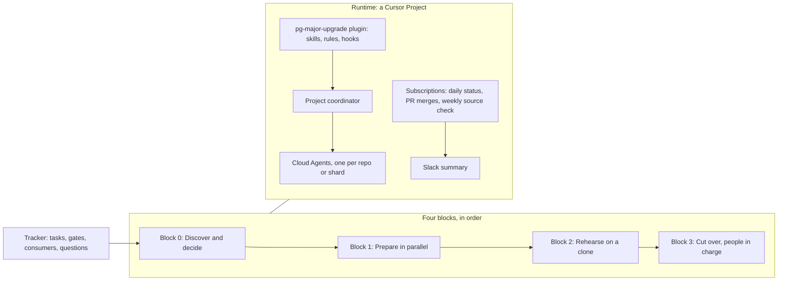

# Postgres major upgrade: Cursor Project template

A Cursor Project template for running a Postgres major version upgrade, from discovery to cutover. Agents do the legwork: searching repos, parsing precheck results, drafting PRs, runbooks and messages, and keeping the tracker current. People make every decision and run every command that touches a database. Every step has a gate, every gate needs evidence, and every claim cites a public source.

It's written for Cloud SQL for PostgreSQL 14 to 18, and the SOP marks each provider-specific step so you can adapt it. The precheck SQL was tested on community Postgres 14 and 18 in Docker, not on Cloud SQL itself; the Cloud SQL facts come from Google's docs, cited and rechecked.

## How it works at a glance



The plugin gives the Project's agents their skills and guardrails. The tracker, a CSV in the Project's shared context, holds the state. A dashboard canvas and a daily Slack summary show it.

## The stages

Each block ends at gates. A gate closes only when its evidence is linked in the tracker and a named person approves it. The full procedure, with every gate and task, is in [reference/sop.md](plugins/pg-major-upgrade/reference/sop.md).

**Block 0: discover and decide.**
- **Agents:** search every org for code that connects to the database, scan each repo, and parse the DBA's precheck output into findings.
- **Agents:** lay out each decision's options and trade-offs from the [decision guide](plugins/pg-major-upgrade/reference/decision-guide.md), rule out what the facts exclude, and turn every missing fact into a question with an owner.
- **People:** run the kit and the provider precheck, confirm owners, make each decision, and sign the decision record. The eleven decisions (path, target, window, data-loss rule, rollback, replicas and so on) are tracker rows from day one. The dashboard and the daily status show which are ready to decide, and what the rest are waiting on.
- **Exits when** (highlights; G0.1 to G0.7 in the SOP are the full list): every consumer and CDC slot has an owner, the kit ran validly on the primary for every database, every provider error and kit finding has an owner and a fix task, provider questions are sent, and the decision record covers path, target, window, rollback, replicas, IaC timing and support dates.

**Block 1: prepare in parallel.**
- **Agents:** run one session per repo or shard, opening PRs for compatibility fixes, catalog fixes, connector upgrades and monitoring. They also draft the runbook.
- **People:** review and merge every PR. Apply the flag and settings IaC now, on the source. The `database_version` change is different: it merges only after the upgrade, as a reconcile, because applying it would start the upgrade.
- **Exits when** (highlights of G1.1 to G1.7): every blocker is fixed in production and the provider precheck is clean, tests pass on the target, connectors support it, password roles are rotated under SCRAM, monitoring works on the target, and the runbook is reviewed.

**Block 2: rehearse on a clone.**
- **People:** run the runbook on a production clone, rollback included, and record timings.
- **Agents:** parse the timing sheets against the window.
- **Exits when** (highlights of G2.1 to G2.9): two rehearsals in a row on a production-shaped clone fit within 75% of the window, with room for a full rollback after the upgrade; CDC sentinels arrive exactly once (or a full re-snapshot fits); the rollback is timed through app validation; and every question only the provider can answer is settled.

**Block 3: cut over.**
- **People:** run the night from the timed runbook, with two go or no-go calls. The first write on the new version is the point of no return.
- **Agents:** act as checklist and scribe, comparing each step's output with what was expected.
- **Exits when:** production runs the target version, CDC is current, the statement set is within 2x of baseline after 24 hours, and close-out is done (G3.1 to G3.4).

## How progress is tracked

- **Tracker.** One CSV where each row is a task, gate, question, consumer, finding, decision or risk. The [schema](plugins/pg-major-upgrade/reference/tracker-schema.md) defines every column and status. [`tracker-check.mjs`](plugins/pg-major-upgrade/scripts/tracker-check.mjs) enforces the rules: no Done without evidence, no closed gate without an approver, no waiver without a linked approval.
- **Dashboard.** [`render-dashboard.mjs`](plugins/pg-major-upgrade/scripts/render-dashboard.mjs) turns the tracker into a canvas with the four blocks side by side, gate status, items needing attention, consumers and open questions. [tests/dashboard.snapshot.canvas.tsx](tests/dashboard.snapshot.canvas.tsx) is a rendered example from the synthetic Acme fixture. Open it in Cursor to see the layout.
- **Daily status.** A Project subscription, or an Automation, updates statuses from PRs and posts a summary to Slack. The summary lists blocked rows, approvals waiting two or more days by owner, and overdue items. The recipes are in [reference/automations.md](plugins/pg-major-upgrade/reference/automations.md).
- **Other trackers.** Set `trackerBackend` to `sheets`, `notion`, `linear` or `jira`, and connect that MCP server. The columns and rules stay the same. If the backend is down, updates queue in `upgrade/tracker-pending.csv`.

## How the work is verified

Four layers:

1. **Gates need evidence and a named approver.** Agents can mark a gate ready, but only a named person closes it, and the checker rejects a closed gate without one.
2. **Every claim cites a public source.** [reference/sources.md](plugins/pg-major-upgrade/reference/sources.md) lists 48 sources (Cloud SQL, DMS, postgresql.org, `pg_upgrade`'s own `check.c`, Debezium, Flink CDC, and Cursor's docs), each with the exact quotes it was checked against. Claims are labeled Verified, Inferred or Unverified. [`check-sources.mjs`](plugins/pg-major-upgrade/scripts/check-sources.mjs) re-fetches every page and fails when a quote is gone, and a weekly subscription runs it. The `sop-auditor` agent answers "where does this come from?"
3. **Independent multi-model review.** `/pg-review` sends a decision record, runbook or gate report to three or four models from different families. Each sees only the files and a rubric. Their findings are checked against sources before anyone acts on them. The template itself went through two rounds of this with Astra (Codex CLI), Gemini 4 Argon, Grok 4.7 and Claude Opus 5.5: [SOP round 1](docs/reviews/2026-11-template-review-round-1-sop.md), [skills round 1](docs/reviews/2026-11-template-review-round-1-skills.md), [round 2](docs/reviews/2026-11-template-review-round-2.md).
4. **Skill evals.** [evals/](evals/) runs each skill headless on synthetic fixtures, across more than one model. Hard gates check decisions and output shape, and a judge from a different model family scores against an answer key. The cases are mostly resilience cases: a precheck run on a replica, ORM output instead of psql, a prompt injection in pasted output, a tracker backend that's down, a request to connect to production. The latest full run passed 16 of 16 cases on both Claude Opus 5.5 and Composer 2.5, with a mean judge score of 0.71 ([results](evals/results/2026-11-04-final.md)). A seventeenth case, added with the decision guide, checks that an agent won't record a decision for the customer even when asked to. Opus passed it 3 times in 3, and Composer 2 times in 3, never recording the decision. The hill-climb log, round by round, is in [evals/HILLCLIMB.md](evals/HILLCLIMB.md).

The precheck SQL itself is tested on Postgres 14 and 18, as superuser and as a read-only role, by [tests/sql/run-precheck.sh](tests/sql/run-precheck.sh).

## Guardrails

| Guardrail | What it protects against |
|---|---|
| Agents never connect to production, a clone or a replica. Every database fact comes from pasted output. | Accidental changes, and regulated data in agent sessions |
| Agents open PRs, and never merge, apply IaC, or push to a default branch | Unreviewed changes reaching production |
| Pasted output is screened before it's saved, and treated as data, never as instructions | Row data leaking into shared files, and prompt injection |
| No guessing: unknowns become question rows | Plans built on invented sizes, owners or dates |
| Hooks deny Postgres clients unless the host is explicitly allow-listed (not even localhost, which can be a Cloud SQL Auth Proxy), provider commands that change state, database MCP tools, IaC applies, PR merges and pushes to a default branch | A backstop for the rules above, not a sandbox: they read command text. Covered by 69 tests. |

## Quick start

**Before you start, have:**
- A written statement from the customer of what agents may touch.
- A DBA who will run read-only queries and paste the results back.
- A Cursor plan with Projects and Cloud Agents. Projects don't work with Privacy Mode (Legacy), and Enterprise teams need Cursor 3.21.9 or later ([S-40](plugins/pg-major-upgrade/reference/sources.md)).
- GitHub access for Cloud Agents to every org that might hold code connecting to the database.
- Optionally, a Slack channel for the daily status.

### 1. Create a team Project

Its workspace should be the repo that will hold `upgrade/` and the plugin's `.cursor/` folder.

### 2. Paste the bootstrap prompt

Paste the [bootstrap prompt](docs/bootstrap-prompt.md) into the Project, with what you know filled in. Leave the rest as `unknown`; each one becomes a question with an owner.

There's nothing to install by hand. If the plugin isn't in the repo yet, the prompt's step 0 has the agent clone this template at the ref you name, run its installer, and open a pull request that adds `.cursor/`: rules, skills, commands and guard hooks. Review it, merge it, and say "continue". Agents never merge, so this first merge is yours too. Pin the ref to a commit or tag, so every Project gets the version you reviewed.

### 3. Approve the setup

The bootstrap writes `upgrade/project.json` and `upgrade/tracker.csv`, searches for code that connects to the database, and stops. It shows you the repo list, the open questions, and the decisions you'll make (D-01 to D-11) with who makes each. Approve the repo list in chat.

### 4. Send the precheck request

The agents start the read-only readiness scans and draft the precheck request for your DBA. Send it, and paste the results back when they arrive.

**Other ways to install.** To manage one plugin version centrally, copy this folder into the root of its own repo, because Cursor reads a marketplace manifest only at a repo's root ([S-51](plugins/pg-major-upgrade/reference/sources.md)), and add it as a team marketplace under Dashboard, Plugins & MCPs. To try it on your own machine, copy `plugins/pg-major-upgrade` into `~/.cursor/plugins/local/` and reload the window; cloud agents won't see a local install ([S-45](plugins/pg-major-upgrade/reference/sources.md)).

### Day to day

| To | Run |
|---|---|
| See where things stand, and render the dashboard | `/pg-status` |
| Think through a decision, or draft the decision record | Ask, for example "help us decide replica handling" (`pg-upgrade-decision-record`) |
| Check whether a block can exit | `/pg-gate` |
| Get an independent review of a decision record, runbook or gate report | `/pg-review` |

**Already under way?** Write a handoff in the shape of [catch-up-handoff-template.md](plugins/pg-major-upgrade/reference/catch-up-handoff-template.md), paste the bootstrap prompt, then run `/pg-catch-up`. Pasted results beat statements, conflicts become questions, and nothing is marked done without evidence.

## What's in the box

```text
.cursor-plugin/marketplace.json     marketplace manifest
plugins/pg-major-upgrade/
  skills/                           bootstrap, precheck, tracker, decision-record, gate-review, runbook, catch-up, model-review
  rules/                            guardrails, evidence-and-sources, workspace-layout (always on)
  commands/                         /pg-status, /pg-gate, /pg-catch-up, /pg-review
  agents/                           independent-reviewer, sop-auditor, findings schema
  hooks/                            shell and MCP guards
  reference/                        SOP, decision guide, sources, tracker and project schemas, readiness scan, automations, handoff template
  assets/                           precheck.sql, tracker seed, dashboard canvas template
  scripts/                          install into a repo, tracker check, dashboard render, source check, review runners
docs/                               bootstrap prompt, review rounds (raw reviewer output is unvetted; the round records are authoritative)
.cursor/rules/                      a rule for working in this repo: treat raw reviews and eval results as unvetted
evals/                              runner, graders, cases, synthetic fixtures, results, hill-climb log
tests/                              template checks, hook tests, precheck SQL test
```

## Commands and skills

| Name | What it does |
|---|---|
| `pg-upgrade-bootstrap` | Writes `project.json` and the tracker, searches for consumers, and stops for approval |
| `pg-upgrade-precheck` | Drafts the DBA request, then screens, validates and parses pasted results into findings |
| `pg-upgrade-tracker`, `/pg-status` | Updates rows, records approvals, writes the daily summary, and renders the dashboard |
| `pg-upgrade-decision-record` | Walks the customer through each decision: facts, gaps, options ruled out, trade-offs, a labeled recommendation. Records what the named decider chose, and drafts the decision record. |
| `pg-upgrade-gate-review`, `/pg-gate` | Gives each gate a pass, fail or needs-decision verdict, and writes the gate report and SOP feedback |
| `pg-upgrade-runbook` | Drafts the runbook, parses rehearsal timings, and runs the cutover checklist |
| `pg-upgrade-catch-up`, `/pg-catch-up` | Loads a handoff for a migration already under way |
| `pg-upgrade-model-review`, `/pg-review` | Runs an independent multi-model review and reconciles the findings |

## Adapting it

- **Another provider (RDS, AlloyDB, Azure, self-managed).** Swap kit section 1 for the provider's precheck, and replace the Cloud SQL rows the SOP lists in [Adapting](plugins/pg-major-upgrade/reference/sop.md#8-adapting-to-another-provider). Add the provider's docs to `sources.json`, with quotes, and run `check-sources.mjs`.
- **A logical migration (DMS, pglogical, pgcopydb).** The SOP's logical branch is an outline that the runbook skill expands. Every Block 2 and 3 gate still applies.
- **Your own evals.** Add a case under `evals/cases/` with a frozen prompt, synthetic fixtures and hard gates. Run `node evals/run-evals.mjs --case <id>`.

## Running the checks

```bash
node tests/check-template.mjs                        # citations, public-only content, links, frontmatter, trackers, snapshot
node --test tests/*.test.mjs                         # guard hooks, tracker rules, installer
tests/sql/run-precheck.sh                            # precheck SQL on Postgres 14 and 18 (needs Docker)
node plugins/pg-major-upgrade/scripts/check-sources.mjs   # live source recheck (needs network)
node evals/run-evals.mjs --list                      # eval cases; drop --list to run (needs cursor-agent login)
```

Rerun the evals before adopting a changed skill. In CI, run them on PRs that touch `plugins/pg-major-upgrade/skills/`. A gate review that catches a skill misbehaving on real work should add a de-identified case that reproduces it.

## Pilot checklist and known limits

These weren't testable when the template was built, so check them in your first real Project:

- [ ] `upgrade/` in the Project's shared context syncs to every agent the coordinator starts ([S-40](plugins/pg-major-upgrade/reference/sources.md)).
- [ ] The coordinator creates the daily-status and PR-merge subscriptions from [automations.md](plugins/pg-major-upgrade/reference/automations.md).
- [ ] Step 0 of the bootstrap prompt installs the plugin as a pull request from a Project agent, and after the merge, new Project agents load the rules, skills, commands and hooks from `.cursor/`. The evals confirm the installed layout for headless local agents, but not the install step itself, which needs network access.
- [ ] The plugin installs from a team marketplace, and its rules, skills and hooks load in Project agents.
- [ ] The hooks fire in Cloud Agents. Cursor documents `beforeShellExecution` and `preToolUse` as supported there, and `beforeMCPExecution` as not available; HTTP MCP tools surface through `preToolUse` as `MCP:<tool>`, which the plugin also guards ([S-47](plugins/pg-major-upgrade/reference/sources.md)). The shell hook was confirmed firing in headless `cursor-agent` runs during the evals; the MCP hooks have only been tested with unit tests.

Known limits:

- The provider-specific content covers Cloud SQL only, and the kit has only run on community Postgres. Run it on a Cloud SQL clone before relying on it.
- The logical-migration branch is an outline.
- The hooks read command text, so they're a backstop, not a sandbox.
- The evals use synthetic fixtures, and real outputs will be messier.
