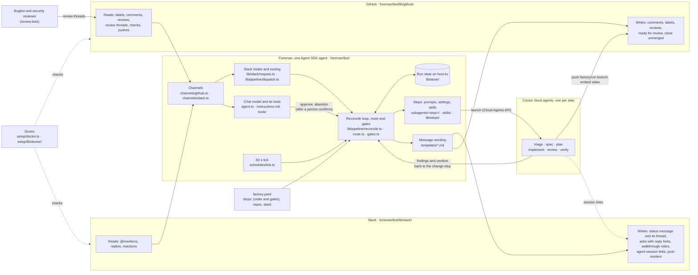
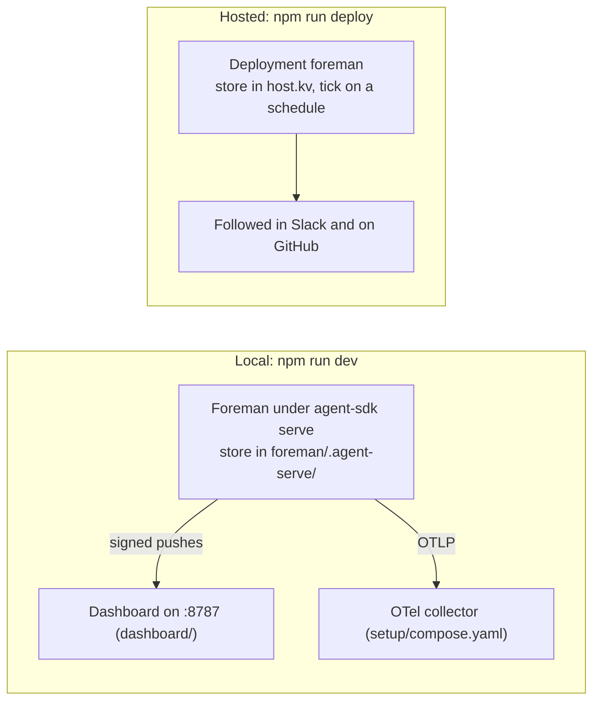

# Architecture

The factory is one deterministic program. Models do the step work (writing a spec, a plan, code, a review); code decides every stage move. This page follows an event from the moment it arrives to the moment the run moves. The picture of the pieces, with the path for each, is the [diagram](#diagram) below.

## Diagram

Where to look when you want to change something. Slack and GitHub sit outside, each with what Foreman reads and writes there and the adapter to change. Inside the Foreman box are its major parts, with their paths under `foreman/bot/`. Cloud agents run in Cursor's cloud, one per step. To change the steps, the gates or the wording, see [docs/customize.md](docs/customize.md).

It runs the same code two ways:

Where Mermaid doesn't render, use the [exported image](docs/images/architecture.png).

## Pieces

| Piece | Where | What it does |
| --- | --- | --- |
| Ingress | [`foreman/bot/lib/pipeline/ingress.ts`](foreman/bot/lib/pipeline/ingress.ts), called by Foreman's [GitHub](foreman/bot/channels/github.ts) and [Slack](foreman/bot/channels/slack.ts) channels | Turns one delivery into at most one trigger naming a run. Reads only. |
| Dispatch | [`foreman/bot/lib/pipeline/dispatch.ts`](foreman/bot/lib/pipeline/dispatch.ts), called by the channels and the [tick schedule](foreman/bot/schedules/tick.ts) | Handles one trigger, then refreshes the run's status line and pushes it to the dashboard. The tick lives here too. |
| Store | [`foreman/bot/lib/store/store.ts`](foreman/bot/lib/store/store.ts), [`foreman/bot/lib/store/runs.ts`](foreman/bot/lib/store/runs.ts) | Everything on the Agent SDK's durable `host.kv`: one document per run, index keys listing the open and closed runs, leases and once-markers. The same code locally and on Cursor hosting. |
| Reconcile | [`foreman/bot/lib/pipeline/reconcile.ts`](foreman/bot/lib/pipeline/reconcile.ts) | Under the run's lock, re-reads its GitHub state and its step's cloud agent, and moves the run. |
| Route and gates | [`foreman/bot/lib/pipeline/route.ts`](foreman/bot/lib/pipeline/route.ts), [`foreman/bot/lib/pipeline/gates.ts`](foreman/bot/lib/pipeline/gates.ts) | The route read from `steps:` in `factory.yaml` (where each step and gate leads, where a send-back goes), and how a gate decision is read from comments and labels. |
| Steps | [`foreman/bot/subagents/`](foreman/bot/subagents/), [`foreman/bot/lib/steps/`](foreman/bot/lib/steps/) | One folder per step: `instructions.md` is its prompt, `agent.ts` its model, deadline, status line, skills and kind. `lib/steps/` loads them, builds each prompt, launches the cloud agent, and checks the result file by kind. |
| Skills | [`foreman/bot/skills/`](foreman/bot/skills/) | Instructions a step lists in its `agent.ts`, appended to its prompt. |
| Ports | [`foreman/bot/lib/pipeline/ports.ts`](foreman/bot/lib/pipeline/ports.ts) | Every outside call (GitHub, Cloud Agents, Slack) behind one interface, so tests swap in fakes. |
| Metrics | [`foreman/bot/lib/metrics/`](foreman/bot/lib/metrics/) | KPIs and DORA from the store, pushed to an OTel collector when one is configured. |
| Dashboard push | [`foreman/bot/lib/dashboard-push.ts`](foreman/bot/lib/dashboard-push.ts) | Signed pushes of run documents and a heartbeat to the dashboard, when `dashboard.enabled` is true. |
| Dashboard | [`dashboard/`](dashboard/) | A separate Next.js app over Postgres (or embedded PGlite). Shows what Foreman pushed; controls nothing. |
| Foreman's model | [`foreman/bot/agent.ts`](foreman/bot/agent.ts), [`foreman/bot/tools/`](foreman/bot/tools/) | Chat only. Its tools read runs, relay a requester's answer to PM, open a request in a shared channel, and, after a person confirms in Slack, approve a gate or abandon a run, counted only for the requester or a listed approver. Commands in Slack are parsed by code before the model sees them. |
| Messages | [`foreman/bot/templates/`](foreman/bot/templates/), [`foreman/bot/lib/templates.ts`](foreman/bot/lib/templates.ts) | The wording of every Slack, issue and pull request message, one topic per file. |
| Slack messages | [`foreman/bot/lib/slack/blocks.ts`](foreman/bot/lib/slack/blocks.ts), [`foreman/bot/lib/slack/status.ts`](foreman/bot/lib/slack/status.ts), [`foreman/bot/lib/slack/post.ts`](foreman/bot/lib/slack/post.ts) | Block Kit layouts for the status message, asks, results and notices, each with a plain-text fallback; the status message edits; uploads. |
| GitHub identity | [`foreman/bot/lib/github/app.ts`](foreman/bot/lib/github/app.ts), [`foreman/bot/lib/runtime.ts`](foreman/bot/lib/runtime.ts) | The token Foreman's own posts use, by `github.identity`: a GitHub App installation token, a bot user's token, or the operator's. |
| Post-mortem | [`foreman/bot/lib/pipeline/postmortem.ts`](foreman/bot/lib/pipeline/postmortem.ts) | The post-mortem for an abandoned or hand-closed run, from its document. |

## One event, start to finish

1. **A delivery arrives.** For example, an approver comments `approve` on issue #12. Foreman's GitHub channel calls `fromGitHub`, which returns `{kind: "reconcile", runId: "f-gh-12"}`. It skips the factory's own comments.
2. **Reconcile takes the run's lock.** Every write to a run happens under its lease, so a run is normally written by one writer at a time, even though on Cursor hosting every scheduled tick starts a runtime of its own. The lease is best effort (see [The host.kv race](#the-hostkv-race)), so every save also carries the run's `rev`, and a save from a stale read fails.
3. **Reconcile reads the truth.** The trigger only names the run. Reconcile asks GitHub whether the PR merged or closed and whether the issue closed, then runs the handler for the run's stage. At a gate it reads every comment and gate label on the issue and pull request.
4. **The gate decides.** Only a vote strictly after the gate opened counts, and only from an approver (a login, or a member of a `team:org/slug`). An earlier vote is stale and logged. A non-approver's vote gets a reply saying it was ignored, and stays ignored even if that person is added to the approvers later. If the branch head moved since the gate opened, the gate reopens on the new head and earlier votes become stale. A vote given in the Slack status thread (a reply or a reaction from the requester or a Slack approver, see [Slack](#slack)) follows the same timing rules, and the first valid vote from either place decides.
5. **The run moves.** `moveTo` appends a transition (stage, reason, the GitHub login who caused it) and makes its sequence number the run's new *visit*.
6. **The next step launches.** On a step stage, reconcile looks for the step run for this visit; there is at most one per visit no matter how many deliveries arrive. With none, it launches the step's cloud agent on `factory/<run>` with the prompt from `foreman/bot/subagents/<step>/instructions.md`, `subagents/common.md` and the step's skills, plus the run's context, and records the agent id, the branch head it started from, and the deadline.
7. **People hear about it.** Every post (issue comment, Slack line, review) goes through `postOnce`, keyed by run, target and a key such as `gate:<visit>`. A replayed delivery finds the key and posts nothing. Issue comments carry a hidden `<!-- factory:<key> -->` marker so ingress can skip the factory's own comments; Slack posts have no markers.
8. **The dashboard hears about it.** If the dashboard is on, the new run document is pushed to it. A failed push is logged at most every 5 minutes and repaired by the next heartbeat; it never fails the reconcile.

Reconcile repeats steps 3 to 6 while the run keeps moving, so one delivery can carry a run from a finished step through to the next launch. A reconcile that throws three times in a row holds the run with the error.

## The tick

Deliveries through `--cursor-events` arrive 3 to 12 minutes late, and a cloud agent does not call back. Every 60 seconds a schedule runs the tick, under a lease so two normally don't overlap:

- a reconcile for every open run, except one whose step agent is still running inside its deadline and that has no Slack status message (a run with one is reconciled anyway, so reactions whose event was missed still count);
- a DORA facts refresh every 10 minutes, and due invoice cost reads;
- pending Slack status-line edits;
- the dashboard heartbeat, which also resends any run the dashboard is missing;
- the metrics push, and once an hour a sweep of old once-markers.

The tick reconciles through the same code a delivery does, so it is not a second path. It is also how a restart, or a hosted process replaced by the platform, picks up whatever happened while it was down.

## Several repositories

`factory.yaml` resolves to one config per repository, all sharing one store and one tick. Every trigger runs in the context of its run's repository, or the repository its payload names. That includes the tick's poll of each step agent. Run ids are `f-<key>-<issue>`, so two repositories never share a run or a branch name.
- **Admission.** A run is active from the moment it has a branch until it's done or closed, gates and holds included. A run over `limits.runsPerRepo` or `limits.runsTotal` waits at intake, oldest first. When a run ends, every waiting run is reconciled straight away, without waiting for the tick.
- **Claim.** Intake skips an issue that's already closed, or that another factory has claimed. It then posts its own claim comment and keeps the run only if that claim is the earliest.
- **Conflicts.** A pull request GitHub reports as `dirty` at the merge gate gets one comment and `blocked: conflict` in its status line. That clears once GitHub reports it mergeable again.

## Watching the pull request until it merges

After Verify passes, the run waits at `awaiting_merge`, and each reconcile reads the pull request's reviews, unresolved review threads and check runs at its head (`feedback` in [`foreman/bot/lib/pipeline/ports.ts`](foreman/bot/lib/pipeline/ports.ts)). Reviews, review comments, pushes and completed checks are delivered as reconciles; the tick catches missed ones.

1. **A new head** since Verify (anyone pushed) sends the run back to the first verdict step after the last change step: Review in the default `steps:`.
2. **New findings** go to the last change step (Implement) as feedback, then Review and Verify again: an unresolved thread from a bot in `review.bots`, a "changes requested" review from a person or an allowlisted bot, or a failed check. Each finding id is recorded in `handled`, so it is sent once. This shares the three send-backs Review and Verify use; past them, Foreman asks the requester in the status thread and waits (`blocked: findings`).
3. **Running checks** keep the pull request a draft (`blocked: checks`). When none are queued, running or failed, Foreman marks it ready and posts "Ready to merge" once per head.

Foreman stops watching when the pull request merges (`done`) or closes, or the run is abandoned. See [Foreman watches the pull request](docs/decisions/foreman-watches-the-pr.md).

## Ending a run

A run ends as `done` (merged), `closed` (a duplicate, or the issue or pull request closed by hand) or `abandoned` (stopped from Slack). Abandoning is recorded on the run (`abandon`: who, why, from where) and reconcile does the rest: an **Abandoning** comment, the agents stopped, the pull request closed unmerged, the `abandoned` label, the issue closed as not planned, then the post-mortem on the issue and in the status thread. A run closed by hand asks for its reason in the status thread and writes the post-mortem once it hears. Triage's context marks abandoned issues, and a repeat Slack request within 30 days links the abandoned issue and its reason. See [Abandoned runs get a post-mortem](docs/decisions/abandoned-runs-get-a-post-mortem.md).

## Steps as cloud agents

Each step is one call to `POST https://api.cursor.com/v0/agents` with the repository, the run branch as both source ref and target branch, the model from the step's `agent.ts`, and the prompt. The step commits its document (if any) and its result file `.factory/<run>/<step>.json` to that branch and stops. When the agent is terminal, reconcile checks, in order:

1. The agent finished (not errored or expired) and reported the run branch.
2. The branch head moved off the commit the agent started from.
3. Every changed file is one the step may write: its result file; for a spec or document step, also its `document` (`specs/<run>.md` for spec, `design/<run>.md` for plan); for a change step such as Implement, anything outside `.factory/`.
4. The result file parses and has the fields the next step needs.

Any failure holds the run, with the reason and the agent link on the issue and in Slack. An approver's `retry` comment starts the stage again as a new visit.

What each result decides depends on the step's `kind` in its `agent.ts`. The order is `steps:` in `factory.yaml`; the default is below.

| Kind (default step) | Result | Next |
| --- | --- | --- |
| `triage` (Triage) | `duplicates`, `related` | Any duplicate closes the issue (and the PR, if one exists) with a note. Otherwise the next step. |
| `spec` (Spec, the PM) | rubric grades, `questions`, `assumptions` | Score under the step's `threshold` with questions left and rounds left: post the questions and wait at `awaiting_clarification`. Otherwise the next step or gate. |
| `document` (Plan) | summary | The next step or gate. |
| `change` (Implement) | summary | The next step. |
| `verdict` (Review, Verify) | `verdict`, `findings`; with `video: true` also `video` | Posted as a pull request review. `changes` sends the findings to the last change step before it (up to three times, then holds). The last verdict's `pass` starts the watch on the pull request. Verify embeds its walkthrough video in the PR description; Foreman links it in the review and uploads the mp4 into the run's Slack status thread with pass or fail and the PR (the link when it can't upload). |

The draft pull request opens after the first step that isn't triage. A gate goes right after the step whose work it approves; its `changes:` sends the run back to that step. Each PM round, each send-back and each gate `changes:` is a new agent whose prompt includes the answers or the feedback. Changing the steps is in [docs/customize.md](docs/customize.md).

## Slack

Slack is optional. It does intake, status, chat and steering.

**Intake.** A top-level @mention in a factory channel opens one issue with the intake label. Foreman replies "Working on it." at once, then posts the run's **status message** at the top level of the channel and replies once more under the request with links to the issue and to the status thread. If an open run in that repository already asks for the same thing (most of the request's content words match its title), Foreman links that run and its thread instead and opens nothing. A run that triage closed as a duplicate within the last 24 hours counts too, with a link to the issue it duplicates; so does a run abandoned within the last 30 days, with its reason.

In a channel one repository uses, that repository gets the issue. In a channel several share, [`foreman/bot/lib/slack/request.ts`](foreman/bot/lib/slack/request.ts) picks one, in this order:

1. A leading key or name (`web: …`, `` `web: …` `` pasted from a hint, `**web**: …`), or `in web` anywhere.
2. The request's content words against each repository's key, name and `description`, with common endings dropped (`games` matches `game`). One repository scoring highest wins.
3. Otherwise Foreman's model gets the list with descriptions and calls `open_request` for the one the request is for. It asks the person only when the request could fairly be either, and opens the issue once they answer.

The first two are pure and tested on real event text, so the common case never waits on a model.

**Two threads.** Every follow-up (agent launches with their Cursor session links, stage moves, questions, gate asks, verify results with the walkthrough video, pull request findings, ready to merge, the post-mortem) goes in the status thread. Foreman still answers in the request thread, with a pointer to the status thread. A run started from the label gets only a status thread. Both threads, and the latest ask, are indexed to the run (`idx/thread/<channel>/<ts>`), so a mention or reaction on any of them finds it.

**Asks.** A question or approval ask mentions the requester (or, for a run started on GitHub, the Slack approvers) and ends with a one-line hint: in Slack, "Reply here and mention @foreman, for example `@foreman approve`", plus the reactions; on the issue, the matching comment syntax.

**Commands.** A mention in either thread is first parsed by code ([`slackCommandOf`](foreman/bot/lib/pipeline/gates.ts)): `approve`, `changes: <what>`, `abandon` or `close` with an optional reason, or the reason Foreman asked for. Only the requester and Slack user ids in `slack.approvers` may use them; anyone else is told who can. Reactions work the same way: the approve or reject reaction on the gate's ask, and the abandon reaction on the status message. A reaction event only triggers a reconcile, which reads the reactions with `reactions.get` and applies the same check. Anything that isn't a command is chat with Foreman's model, which can read runs and relay an answer to PM. See [Slack approvals, checked in code](docs/decisions/slack-approvals-checked-in-code.md).

**The status message** is Block Kit: a header with the run and repository, the stage line, a context line with the issue, pull request and running agent session links, and the reply hint. Foreman edits it with `chat.update` as the run moves. Edits are coalesced: an edit goes out only when the text changed, at most one per run every 10 seconds and one per second across runs. A rate limit pauses edits for its Retry-After. If the message was deleted, Foreman posts a fresh one. A status edit never holds a run ([`foreman/bot/lib/slack/status.ts`](foreman/bot/lib/slack/status.ts)). The issue gets the same summary in one comment Foreman edits in place.

**The walkthrough video** is uploaded into the status thread with `files.getUploadURLExternal` and `files.completeUploadExternal`, so Slack plays it inline; on any failure Foreman posts the link ([decision](docs/decisions/verify-video-in-the-pull-request.md)).

Slack stamps a `bot_id` on a message a person posts through an app (a test harness, a workflow, a client using an app's user token), and the Agent SDK drops such mentions unless the author is on `engagement.botMentions.allowFrom`. So Foreman reads the channel's members when it starts and allowlists the people (not bots, not deactivated accounts) by user id. `slack.testerBot` adds one bot id on top, for automated tests that post as a bot. Someone who joins the channel later is admitted after Foreman's next restart.

## Invoice cost

With `CURSOR_ADMIN_API_KEY`, the tick reads cost whenever some finished agent's next read is due: a minute after it finishes, then a quarter of its age later (2 to 15 minutes). The tick sums `chargedCents` over the agent's usage events, de-duplicated by `usageEventId`, and replaces the stored figure. A figure unchanged for 30 minutes, or read 2 hours after the finish, is final and not read again. The run page labels each figure settling or final; the cost-per-task metric uses only final ones. See [COST.md](COST.md).

## Metrics path

When `OTEL_EXPORTER_OTLP_ENDPOINT` is set, each tick computes every KPI and DORA value from the store and pushes the whole set to the collector as OTLP/HTTP JSON. A metric without a value is sent as `factory.metric.not_emitted{metric, reason}`. Because the push is a full snapshot, a lost push costs nothing.

## Dashboard

The dashboard is optional (`dashboard.enabled` in `factory.yaml`) and one-way. Foreman pushes each run document after it changes, and a heartbeat every minute listing every open or recently closed run with its `rev`. The dashboard keeps a document only when its `rev` is newer, and answers the heartbeat with the runs it lacks, so retries and duplicates are harmless and a wiped dashboard refills within a minute. Each push is signed with HMAC-SHA256 over a timestamp and the body, keyed by `SA_PORTAL_INGEST_SECRET`; the dashboard refuses stale, wrong and replayed signatures. Viewers sign in through the dashboard's own auth mode (none, a shared login, or an SSO proxy header). The wire format is in [docs/portal-api.md](docs/portal-api.md).

With the dashboard off, or on without a URL or secret, Foreman sends nothing; the second case warns once at start. Nothing about the dashboard can hold or fail a run.

## The host.kv race

The full list of known issues is [in the reference](docs/reference.md#known-issues). This is the one that comes from the design.

**Overlapping sessions can, rarely, double a tick, a step launch or a post.** On Cursor hosting every scheduled tick starts a runtime of its own, and Slack and GitHub deliveries run beside it, so two sessions can work on one run at once. The run's lease and the once-keys are stored in `host.kv`, which in `@grok/agent-sdk` 0.3.0 has only get, put and delete: no compare-and-set, no list, no expiry. So a lease or once-key is claimed by writing a fresh token, waiting 150 ms, and reading it back. Two sessions that claim within that window can both read their own token, and then both run the tick, both launch the stage's step agent, or both make the same post. The open-runs list (`idx/open`) is a read-modify-write value too: a racing write can drop an id, which comes back the next time that run is saved.

Intake is human-driven (a label or a Slack message), so collisions should be rare. What limits the damage:

- every run save carries the run's `rev`, and a save from a stale read fails instead of overwriting;
- side effects are keyed: posts by (run, target, key), step runs by (run, visit), Slack intake and relayed answers by once-keys, so a repeated delivery or a later tick finds the key and does nothing.

The fix is for `host.kv` to expose the `putIfAbsent` and `putIfVersion` that the Agent SDK's storage layer already has (`HostKvCasApi`). Then a lease and a once-key become a single conditional write, and the window closes. See the [decision record](docs/decisions/state-on-host-kv.md).

## Decisions

- [Steps run as cloud agents](docs/decisions/roles-run-as-cloud-agents.md)
- [State on host.kv](docs/decisions/state-on-host-kv.md)
- [Slack approvals, checked in code](docs/decisions/slack-approvals-checked-in-code.md)
- [Foreman's own GitHub identity is a choice](docs/decisions/factory-github-identity.md)
- [Foreman watches the pull request until it merges](docs/decisions/foreman-watches-the-pr.md)
- [Abandoned runs get a post-mortem](docs/decisions/abandoned-runs-get-a-post-mortem.md)
- [Track the run on its GitHub issue](docs/decisions/track-on-the-github-issue.md)
- [Slack stays, Linear and Jira go](docs/decisions/slack-not-linear-or-jira.md)
- [Slack requests find their repository](docs/decisions/slack-requests-find-their-repository.md)
- [One TypeScript package](docs/decisions/one-typescript-package.md)
- [Metrics go through the collector](docs/decisions/metrics-through-the-collector.md) (the dashboard computes its tiles from pushed run documents)
- [The verify walkthrough lives in the pull request, and plays in Slack](docs/decisions/verify-video-in-the-pull-request.md)
- [Hosted deploys are recorded](docs/decisions/deploys-are-recorded.md)
