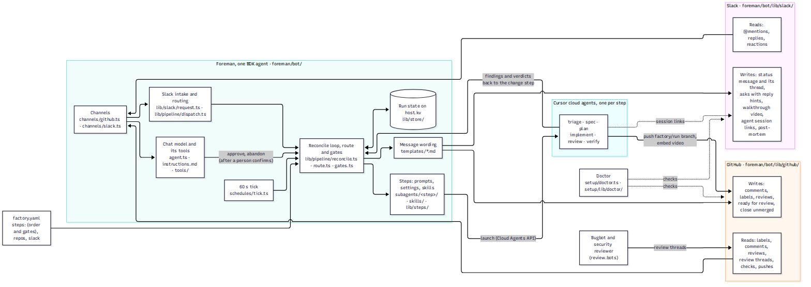

# Drop-in Software Factory

> **First time running the factory?** Follow the step-by-step [tutorial](docs/tutorial.md). It walks through every account, secret, command and screen, with the expected output at each step, from setup to a merged pull request.

Label a GitHub issue, or ask in Slack, and the factory takes it to a pull request ready to merge. Each step of the pipeline (by default Triage, Spec, Plan, Implement, Review and Verify) runs as a Cursor cloud agent on the run's branch, and `factory.yaml` sets their order and the gates between them. People answer questions and approve on GitHub or in the run's Slack thread. Foreman, the agent that runs the factory, then watches the pull request until it merges: Bugbot and security review findings, change requests and failed checks go back to the agents.

The factory lives in its own repository and works on the repositories `factory.yaml` lists. It can also sit inside one of them. Everything it needs is inside this folder.

## What's where

| Path | What it is |
| --- | --- |
| [`foreman/bot/`](foreman/bot/) | Foreman, the one Agent SDK agent. |
| &nbsp;&nbsp;[`agent.ts`](foreman/bot/agent.ts) | Its chat model and hosting (egress and secret names). |
| &nbsp;&nbsp;[`instructions.md`](foreman/bot/instructions.md) | Its chat rules. |
| &nbsp;&nbsp;[`subagents/<step>/`](foreman/bot/subagents/) | One folder per pipeline step: `instructions.md` is its prompt, `agent.ts` its model, deadline and kind. |
| &nbsp;&nbsp;[`tools/`](foreman/bot/tools/) | What the chat can call: read runs, relay answers, and, once a person confirms, approve a gate or abandon a run. |
| &nbsp;&nbsp;[`channels/`](foreman/bot/channels/) | GitHub and Slack. |
| &nbsp;&nbsp;[`hooks/`](foreman/bot/hooks/) | The audit log: one line per chat turn. |
| &nbsp;&nbsp;[`schedules/`](foreman/bot/schedules/) | The minute tick that reconciles every open run. |
| &nbsp;&nbsp;[`templates/`](foreman/bot/templates/) | Every Slack, issue and pull request message Foreman posts. |
| &nbsp;&nbsp;[`lib/`](foreman/bot/lib/) | The pipeline code: `pipeline/` (route, gates, reconcile), `steps/`, `store/`, `github/`, `slack/`, `config/`, `metrics/`. |
| [`dashboard/`](dashboard/) | The optional dashboard, a small Next.js app. Foreman pushes to it; it never controls anything. |
| [`setup/`](setup/) | What the `npm run` commands run: `dev`, `doctor`, `deploy`, and `check`, `verify`, `verdict`, `stop`, `github-app`. |
| [`factory.yaml`](factory.yaml) | The one settings file, including `steps:` (the pipeline and its gates). |
| [`docs/customize.md`](docs/customize.md) | How to change it: prompts, models, gates, steps, skills and messages. |

Also at the top level:

- `ARCHITECTURE.md`, `COST.md`, `PREREQUISITES.md`, `TESTING.md` and `AGENTS.md` (the rules for agents that change this code).
- `ci/` and `examples/github-workflows/`: the offline isolated-copy check and CI to copy into `.github/workflows/`.
- `package.json`, `package-lock.json`, `.nvmrc`, `tsconfig.json`, `.gitignore` and `.env.example`.

Tests live next to what they test: `foreman/tests/` and `setup/tests/`. Foreman's step skills are in `foreman/bot/skills/`, and the metrics collector is `setup/compose.yaml`. The rest of the docs, including the full [reference](docs/reference.md), are in [`docs/`](docs/).

## Quickstart

```bash
cd my-factory                         # a copy of this folder, in its own repository
npm install
npm run install:all                   # Foreman's and the dashboard's packages
cp .env.example .env                  # fill in the secrets; edit factory.yaml
npm run doctor                        # every line should say ok
npm run dev                           # Foreman, plus the dashboard on http://127.0.0.1:8787
```

Every command runs the same in bash, zsh and PowerShell, on macOS, Linux and Windows. The scripts read `.env` themselves.

Then add the `factory:run` label to an issue. The [tutorial](docs/tutorial.md) explains each line and what you should see after it; the [reference](docs/reference.md) covers every setting, going hosted, and a run from start to merge.

## For agents

Setting this up for someone? Have your coding agent follow [docs/agent-setup.md](docs/agent-setup.md). It walks through each step, running and checking each command itself, and says which ones need the person (creating the Slack app, choosing Foreman's GitHub identity, pasting secrets). Changing the factory's own code instead? The rules are in [AGENTS.md](AGENTS.md).

## Overview

### Is this for you?

Use it when your code is on GitHub, your team can use Cursor cloud agents, and you want each request to go through a spec, a dev plan and a review before a person merges it. Skip it if you need a different code host, a tracker other than GitHub issues, or a pipeline that isn't a sequence of cloud-agent steps with gates between them.

### What you get

- One settings file, [`factory.yaml`](factory.yaml), validated strictly by [`foreman/bot/lib/config/factory.ts`](foreman/bot/lib/config/factory.ts).
- Foreman, which receives GitHub and Slack events, moves the runs, and chats in Slack.
- Pipeline steps you add, remove or reorder in `factory.yaml` ([docs/customize.md](docs/customize.md)).
- An optional dashboard with every run's timeline, cloud agents, compute minutes and KPIs, run next to Foreman or [hosted anywhere](docs/reference.md#host-the-dashboard-anywhere).
- Metrics over OpenTelemetry to any collector.
- Tests that drive the whole pipeline against in-memory GitHub, Cloud Agents and Slack (`npm test`).

A small issue with no waits on people takes about 10 to 15 minutes from label to a pull request ready to merge.

## Architecture



Each run is one document in the Agent SDK host's durable key-value store. Every input names a run, and Foreman reconciles that run under a per-run lock: it re-reads the issue, the pull request, the branch and the step's cloud agent, then moves the run as far as it can. The 60-second tick reconciles every open run, so a lost delivery or a restart costs at most a minute. The route is the `steps:` list in `factory.yaml`. The diagrams with the path for each part, and why each piece is shaped this way, are in [ARCHITECTURE.md](ARCHITECTURE.md).

### Cost

Each step is one cloud agent, so a run with the default six steps and no send-backs is six agents, plus one more spec agent per round of questions and one more Implement and Review pair per send-back. The dashboard shows each agent's compute minutes, and invoice dollars when `CURSOR_ADMIN_API_KEY` (a Team Admin API key) is set. For scale: a small docs change with no questions and no send-backs (six agents) was billed $0.78, and five sample runs averaged $1.04. Per-run figures, how the dashboard reads them, and the settings that change them are in [COST.md](COST.md).

### Security

Three long-lived keys authenticate, plus the GitHub App key or bot user token when `github.identity` picks one, and all live only in Foreman's environment (`.env`, git-ignored), read in one place, [`foreman/bot/lib/config/env.ts`](foreman/bot/lib/config/env.ts). `GH_TOKEN` is a GitHub token whose blast radius is the repositories in `factory.yaml`: it can write contents, issues and pull requests there, though the worker never pushes code and never merges. `CURSOR_API_KEY` is a Cursor API key that can launch cloud agents billed to your team, on any repository its account can see. `CURSOR_ADMIN_API_KEY` is optional and reads your team's usage. Cloud agents never receive any of them, each step can change only the files its kind allows, on its own run branch, and only approvers move a gate: listed logins on GitHub, or in Slack the requester and listed Slack user ids, checked by code. Grant the GitHub token least privilege: only the scopes above, on only these repositories. The threat model is in [docs/security.md](docs/security.md).

## Prerequisites

- **Cursor**: a plan with cloud agents enabled, and an API key (`CURSOR_API_KEY`) whose account is connected to GitHub in Cursor with access to the repositories.
- **The Cursor GitHub app** installed on the repositories with write access, and a cloud agent environment so Verify can run your tests.
- **A GitHub token** (`GH_TOKEN`) that can read and write contents, issues and pull requests, and **`gh`** on Foreman's `PATH`.
- **Node.js 22.14 or later** (the tested minimum is in [`.nvmrc`](.nvmrc)).
- **The Agent SDK**, the public npm package `@grok/agent-sdk` (0.3.0, pinned in [`foreman/package.json`](foreman/package.json)), which `npm run install:all` installs. Its CLI has two names, `agent-sdk` and `bdk`, that run the same program; the docs use `npx --yes @grok/agent-sdk@0.3.0 <command>`, which runs `agent-sdk`.
- **Optional**: Slack (an app made from [`foreman/.slack/manifest.prod.json`](foreman/.slack/manifest.prod.json)), Foreman's own GitHub identity (a GitHub App or bot user), and an OTel collector (`docker compose -f setup/compose.yaml up -d`).

The checklist, how to tell each item is done, and the setup snags seen so far are in [PREREQUISITES.md](PREREQUISITES.md).

## Setup and use

Copy the folder out, fill in `.env` and `factory.yaml`, and run `npm run doctor`, as in the [Quickstart](#quickstart). Every setting and variable is in the [reference](docs/reference.md#configure).

### Deploy

```bash
npm run dev
```

`npm run dev` starts Foreman under `agent-sdk serve`, plus the dashboard on <http://127.0.0.1:8787> while `dashboard.enabled` is true. GitHub deliveries arrive through your Cursor account, so no public URL is needed. Foreman starts in about 30 seconds, and its first tick runs within a minute. To run Foreman as a Cursor-hosted deployment instead, `npm run deploy`: see [Go hosted](docs/reference.md#go-hosted). A run from start to merge, gates and abandoning are in [Day-to-day use](docs/reference.md#day-to-day-use-a-run-from-start-to-merge).

### Verify

```bash
npm run typecheck
npm test
```

Expected: `npm test` ends with `# fail 0`. The tests run the full route, replays, gate authority, failures, restarts, Slack intake, status threads, reaction approvals, the pull request watch, abandoning, and the `Ports` conformance contract against in-memory fakes in a few seconds. For a live check, run [Verify a running factory](docs/reference.md#verify-a-running-factory) on a test issue.

### Teardown

```bash
npm run stop                                               # or Ctrl-C where npm run dev runs
docker compose -f setup/compose.yaml down                  # if you started the collector
npx --yes @grok/agent-sdk@0.3.0 deployment delete foreman     # if you deployed it hosted
```

A slow stop is expected, not a hang: Foreman finishes any Slack reply it's writing and flushes telemetry (typically under a second idle, and several seconds mid-reply). If `npm run stop` still finds it after 30 seconds, `npm run stop -- --force`; runs and costs are already in the Agent SDK's store ([tutorial Clean up](docs/tutorial.md#clean-up)). The folder creates no cloud resources besides the cloud agents each run launches, which stop on their own. Delete `foreman/.agent-serve/` and `dashboard/.data/` to forget past runs.

## Limitations

- Common snags (an API key whose account can't see the repository, a step touching a file it may not, a stale approval, a Slack request routed to the wrong repository, cost not shown yet), with symptom, cause and fix: [troubleshooting in the tutorial](docs/tutorial.md#common-errors-and-fixes). Which files each step may write is enforced in [`foreman/bot/lib/steps/results.ts`](foreman/bot/lib/steps/results.ts).
- Steps are added, removed and reordered in `factory.yaml`, but each step's result must be one of the kinds Foreman knows (`triage`, `spec`, `document`, `change`, `verdict`; see [docs/customize.md](docs/customize.md#add-or-remove-a-step)). A new kind needs code.
- GitHub is the only code host, and the GitHub issue is the only tracker.
- Gates are approved on GitHub by a listed login or team member, or in the Slack status thread by the requester or a listed Slack user id. An approval counts only after the gate opened, and only if the branch has not changed since.
- One Foreman owns its runs; two Foremen on the same repositories both claim issues and the earliest claim wins. One Foreman serves up to 20 repositories under one GitHub owner.
- Cloud agent start time (a minute or two per step) and delivery latency put a floor of roughly 10 minutes under a run with no human waits.
- Hosted Foreman has its own caveats (no metrics by default, the dashboard untested hosted, a rare double post): [Known issues](docs/reference.md#known-issues).

## Extensibility

[docs/customize.md](docs/customize.md) walks through each change: editing a step's prompt, changing a model or gate, adding or removing a step, adding a skill, and rewording Foreman's messages.

- **Models and deadlines**: `model` and `deadlineMinutes` in [`foreman/bot/subagents/<step>/agent.ts`](foreman/bot/subagents/). Model ids are from `GET https://api.cursor.com/v0/models`; the doctor checks them.
- **What a step does**: edit [`foreman/bot/subagents/<step>/instructions.md`](foreman/bot/subagents/). [`foreman/bot/subagents/common.md`](foreman/bot/subagents/common.md) is added to every step, and [skills](foreman/bot/skills/) to the steps that list them.
- **Which steps run, and who approves**: the `steps:` list in [`factory.yaml`](factory.yaml), with `approvers` on each gate as logins or `team:org/slug`.
- **What Foreman says**: [`foreman/bot/templates/`](foreman/bot/templates/).
- **Dashboard**: [`dashboard/app/`](dashboard/app/) for pages, [`dashboard/src/lib/kpi.ts`](dashboard/src/lib/kpi.ts) for the tiles. It reads only what Foreman pushes ([docs/portal-api.md](docs/portal-api.md)).
- **CI**: copy [`examples/github-workflows/`](examples/github-workflows/) into `.github/workflows/`.
- **Swap GitHub, Cloud Agents or Slack**: every call the pipeline makes outside its store goes through the `Ports` interface in [`foreman/bot/lib/pipeline/ports.ts`](foreman/bot/lib/pipeline/ports.ts); `livePorts` is the shipped implementation. To swap one, write a new implementation of `Ports`, add it to the list at the top of [`foreman/tests/conformance.test.ts`](foreman/tests/conformance.test.ts) and make that contract pass, then construct it where Foreman builds `livePorts`, in [`foreman/bot/lib/runtime.ts`](foreman/bot/lib/runtime.ts). The gate rules and webhook parsing still assume GitHub issues and pull requests, so another code host also needs [`foreman/bot/lib/pipeline/ingress.ts`](foreman/bot/lib/pipeline/ingress.ts) changed.

## Related

Cursor docs: <https://cursor.com/docs>. Cloud Agents API: <https://cursor.com/docs/background-agent/api/overview>. Agent SDK (`@grok/agent-sdk`): <https://cursor.com/docs/bdk>.
