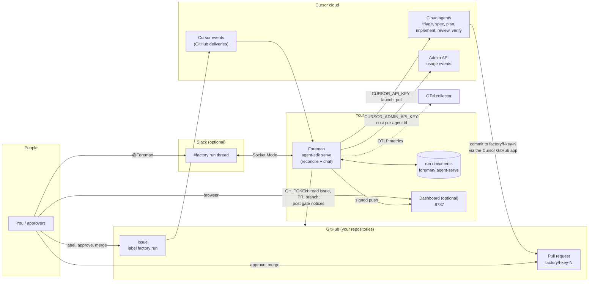

# Tutorial: run the factory for the first time

This walks you through your first run of the Drop-in Software Factory, from an empty laptop to a merged pull request. It assumes you have never run it before. Every step has the same five parts:

- **Do**: what the step is for.
- **Command or click**: exactly what to type or press.
- **You should see**: the expected output or screen.
- **It worked if**: a quick check before you move on.
- **If it goes wrong**: the errors people actually hit, and the fix for each.

Don't skip ahead. Most problems on a first run come from an earlier step that looked fine.

The samples below use `your-org`, repositories named `agents` and `garden`, and a placeholder channel id. Each **You should see** says what to look for on your own GitHub, Slack and dashboard pages.

## Contents

1. [How the pieces connect](#how-the-pieces-connect)
2. [Prerequisites](#prerequisites)
3. [Steps](#steps)
   - [Step 1: Give the API key's account GitHub access](#step-1-give-the-api-keys-account-github-access)
   - [Step 2: Copy the folder and install](#step-2-copy-the-folder-and-install)
   - [Step 3: Secrets, and where to save them](#step-3-secrets-and-where-to-save-them)
   - [Step 4: The Slack app](#step-4-the-slack-app)
   - [Step 5: The config file, `factory.yaml`](#step-5-the-config-file-factoryyaml)
   - [Step 6: Start the factory](#step-6-start-the-factory)
   - [Step 7: Run the doctor](#step-7-run-the-doctor)
   - [Step 8: Start your first run](#step-8-start-your-first-run)
   - [Step 9: Answer questions and approve the gates on GitHub](#step-9-answer-questions-and-approve-the-gates)
   - [Step 10: Review and merge the pull request](#step-10-review-and-merge-the-pull-request)
   - [Step 11: Chat with Foreman in Slack](#step-11-chat-with-foreman-in-slack)
   - [Step 12: Read the dashboard and the cost](#step-12-read-the-dashboard-and-the-cost)
   - [Step 13: Run Foreman on Cursor hosting (optional)](#step-13-run-foreman-on-cursor-hosting-optional)
4. [Common errors and fixes](#common-errors-and-fixes)
5. [Clean up](#clean-up)

## How the pieces connect

One command, `npm run dev`, starts the two processes you need on your machine: **Foreman** and the optional **dashboard**. Each pipeline step (six by default) runs as a Cursor cloud agent in Cursor's cloud. Nothing needs a public URL: GitHub events reach Foreman through your Cursor account (`--cursor-events`), Slack connects to it over Socket Mode, and Foreman pushes to the dashboard on `127.0.0.1`.



What that means for the steps below:

- **Foreman** is the one long-running agent. Each run is one document in its durable store. Every GitHub delivery, Slack mention and the 60-second tick names a run, and Foreman moves that run as far as it can.
- Foreman reads GitHub with `GH_TOKEN` and launches the step agents with `CURSOR_API_KEY`.
- The **step agents** push to the run branch through the **Cursor GitHub app**, not through `GH_TOKEN`. That's why the API key's account needs its own GitHub access (Step 1).
- The **dashboard** only shows what Foreman pushes to it, signed with a shared secret. It controls nothing, and it computes its KPI tiles from the runs, so it needs no collector. Turn it off, or host it elsewhere, in `factory.yaml` (Step 5).

## Prerequisites

The full checklist, with how to tell each item is done, is in [PREREQUISITES.md](../PREREQUISITES.md). In short, before Step 1 you need:

- [ ] A GitHub repository you can push to, with Issues turned on
- [ ] A Cursor plan with cloud agents, and the Cursor GitHub app installed on the repository
- [ ] Node.js 22.14 or later, `gh` and `lsof`
- [ ] Docker (or `otelcol-contrib`) for the metrics collector
- [ ] Optional: a Slack workspace where you can create apps, and a Cursor team admin for the Admin API key

Each line below has a check that proves it's in place.

| You need | Why | Check |
| --- | --- | --- |
| A GitHub repository you can push to, with Issues turned on | The factory works on its repositories | You can open `https://github.com/<owner>/<repo>/issues` |
| A Cursor plan with cloud agents enabled | Each step is a cloud agent | [cursor.com/agents](https://cursor.com/agents) opens and lets you start an agent |
| The **Cursor GitHub app** installed on the repository with write access | Cloud agents push the run branch through it | [cursor.com/dashboard](https://cursor.com/dashboard) → **Integrations** → GitHub shows the repository |
| A **cloud agent environment** for the repository (recommended) | Verify installs dependencies and runs your tests in it | Without one, Verify can only read the code |
| Node.js **22.14 or later** | Foreman and the dashboard (not Bun) | `node --version` prints `v22.14.0` or later |
| `gh`, the GitHub CLI | Issue timeline and Deployments queries | `gh --version` |
| `lsof` (built into macOS; a package on Linux) | The doctor's check of who holds ports 8787 and 8790 | `lsof -v` |
| A Slack workspace where you can create apps (optional) | Run threads, chat, and requests from Slack | You can open [api.slack.com/apps](https://api.slack.com/apps) |
| Someone who is a Cursor **team admin** (optional) | Creates the Admin API key for invoice cost | Ask them now; it's the one thing you may wait on |
| Docker with Compose, **or** the `otelcol-contrib` binary | Runs the collector the factory sends its metrics to (Step 6) | `docker compose version` or `otelcol-contrib --version` |

Every check command should print a version, and every page should open: `node --version` starts with `v22.` and your repository is listed in Cursor's GitHub integration.

| Symptom | Fix |
| --- | --- |
| `node --version` prints 18 or 20 | Install 22.14 (`nvm install 22.14 && nvm use 22.14`; the folder has an `.nvmrc`). |
| The repository isn't in Cursor's GitHub integration | Click **Manage** next to GitHub and add the repository to the Cursor app installation. An org owner may have to approve it. |
| Your team uses privacy mode and cloud agents are greyed out | A Cursor admin has to allow cloud agents for the team. |

## Steps

### Step 1: Give the API key's account GitHub access

**Do.** Pick the Cursor account Foreman will launch agents as, and prove that account can see the repository. This is the step that most often goes wrong.

Here is the pitfall. `CURSOR_API_KEY` belongs to one Cursor user or service account. Cloud agents run *as that account*, and they reach GitHub through *that account's* connection to the Cursor GitHub app. Your own GitHub access doesn't count, and neither does `GH_TOKEN`. In our test, a key from a newly invited test member was accepted by the API and listed every model, but the account had never connected GitHub. It could see **0 repositories**, and the first step launch failed with:

```text
Cloud Agents POST /agents returned 400: {"error":"Failed to verify existence of branch 'factory/f-gh-79' in repository your-org/agents. Please ensure the branch name is correct."}
```

The branch did exist. The account just couldn't see it.

**Command or click.**

1. Sign in to [cursor.com](https://cursor.com) **as the account that will own the key** (a service account is fine).
2. Go to [cursor.com/dashboard](https://cursor.com/dashboard) → **Integrations** → **GitHub** → **Connect**, and grant access to the repository.
3. On the same **Integrations** page, create an API key. This is `CURSOR_API_KEY`. Copy it straight into your secrets file (Step 3).
4. Check whose key it is, and what it can see. If someone handed you the key, the first call is how you find out which account it belongs to:

```bash
curl -s -u "$CURSOR_API_KEY:" https://api.cursor.com/v0/me
curl -s -u "$CURSOR_API_KEY:" https://api.cursor.com/v0/repositories
```

**You should see.** The key's name and its account's email, then JSON that lists your repository, like this:

```json
{"apiKeyName":"factory","createdAt":"2026-10-20T17:02:11.000Z","userEmail":"factory-bot@example.com"}
{"repositories":[{"owner":"your-org","name":"agents","repository":"https://github.com/your-org/agents"}]}
```

**It worked if.** `userEmail` is the account you meant to launch agents as, and your `owner/name` is in the list. The doctor (Step 7) runs this same check and fails if it isn't.

**If it goes wrong.**

| Symptom | Fix |
| --- | --- |
| `{"repositories":[]}` | The key's account hasn't connected GitHub, or its installation doesn't include the repository. Check whose key it is with `/v0/me`, then redo steps 1 and 2 **as that account**, or use a key from an account that has access. |
| `429` | `/v0/repositories` is rate limited. Wait a minute and try again. |
| `401` | The key was copied wrong or revoked. Make a new one. |
| A held run says `Failed to verify existence of branch 'factory/f-…'` | Same cause. Fix the account's access, then comment `retry` on the issue. |

### Step 2: Copy the folder and install

**Do.** Give the factory a repository of its own and install its packages. The factory works on the repositories you list in `factory.yaml` (Step 5), so it doesn't have to live inside any of them. Putting it in a folder of one of them also works.

**Command or click.** On GitHub, create an empty private repository, for example `your-org/factory`. Copy this folder's contents (`solution-accelerators/drop-in-factory` in [cursor/cookbook](https://github.com/cursor/cookbook); see [Copy the folder out](reference.md#copy-the-folder-out)) to the root of a clone of it, then:

```bash
cd factory
npm install
npm run install:all              # Foreman's and the dashboard's packages
```

Every command in this tutorial runs the same in bash, zsh and PowerShell.

**You should see.** Each install finishes with `added N packages` and no `ERR!` lines.

**It worked if.** Running `npm test` prints `# fail 0` at the end. Those tests run the whole pipeline against fakes, so they need no secrets.

**Your verdict ledger** goes in `setup/verdicts/`, which `npm run verdict` and `npm run deploy` create.

**Taking a newer factory later.** Copy the new template over yours, keeping `factory.yaml`, `.env`, `setup/verdicts/`, any `*.local.*` file and the installed packages, then run `npm install` and `npm run check` again. Compare the new template's `factory.yaml` with yours for keys it added. A hosted Foreman keeps the old code until you deploy again (Step 13).


**Commit it or not?** Commit it: a hosted Foreman (Step 13) is built from a pushed branch, and your team shares `factory.yaml` and the step prompts that way. A local Foreman reads the folder from the disk it runs on and the step agents never need it, so an uncommitted copy also runs. Git already ignores `.env`, `data/`, `dashboard/.data/`, Foreman's store and `*.local.yaml`, so secrets and run state stay out.

**If it goes wrong.**

| Symptom | Fix |
| --- | --- |
| `SyntaxError` about types or `--experimental-strip-types` | You're on an older Node. Use 22.14 or later. |
| `EACCES` during install | Don't use `sudo`. Fix the ownership of the folder, or use `nvm`. |

### Step 3: Secrets, and where to save them

**Do.** Collect the secrets in one file that is never committed, and load it into every shell that runs the doctor or the factory.

**Command or click.**

```bash
cp .env.example .env
chmod 600 .env
```

Then open `.env` in an editor and fill in each value:

| Variable | Where to get it | Notes |
| --- | --- | --- |
| `GH_TOKEN` | github.com → your avatar → **Settings** → **Developer settings** → **Personal access tokens** → **Fine-grained tokens** → **Generate new token**. Under **Repository access** pick only your repositories. Under **Permissions** set **Contents**, **Issues** and **Pull requests** to *Read and write*. If an approver is a `team:org/slug`, also set the organization's **Members** permission to *Read*. | With `github.identity: personal` (Step 5), Foreman posts gate notices and opens Slack requests' issues as this login. With an app or a bot user, it posts as that instead, and this token only reads the issue timeline and relays answers from Slack. This login may also be an approver: the factory's own notices carry a hidden marker and are never read as decisions, so an `approve` from the same login counts like anyone else's. |
| `CURSOR_API_KEY` | Step 1. | Must belong to the account with GitHub access. |
| `SA_GH_APP_ID`, `SA_GH_APP_PRIVATE_KEY` | `npm run github-app` writes both (Step 5). | Only with `github.identity: app`. |
| `SA_GH_BOT_TOKEN` | A fine-grained token on the bot account, with the same permissions as `GH_TOKEN`. | Only with `github.identity: bot-user`. |
| `CURSOR_ADMIN_API_KEY` | A Cursor team admin creates it in the dashboard's team settings under **Admin API keys**. | Optional. Without it the dashboard shows compute minutes but no dollars. It must come from the team of the account behind `CURSOR_API_KEY`, because usage is per team; the doctor checks this (Step 7). |
| `SA_PORTAL_INGEST_SECRET` | Run `openssl rand -hex 32` and paste the output. | The key Foreman signs dashboard pushes with. `npm run dev` gives the dashboard the same value. If you leave it empty, `npm run dev` makes a throwaway one, the dashboard still works, but the doctor fails its dashboard line because it can't probe. |
| `SA_PORTAL_URL` | Leave `http://127.0.0.1:8787`. | Where the dashboard listens. Change it only if 8787 is taken. |
| `FOREMAN_SLACK_BOT_TOKEN`, `FOREMAN_SLACK_APP_TOKEN` | Step 4. | Only if you use Slack. |
| `SA_FACTORY_CONFIG`, `OTEL_EXPORTER_OTLP_ENDPOINT` | Leave the defaults from `.env.example`. | `SA_FACTORY_CONFIG` is relative to the factory folder. The collector endpoint is the one you start in Step 6; the doctor fails while it is empty. |

Every `npm run` command reads `.env` from the factory folder itself, so there's nothing to load into your shell.

Where to keep secrets beyond your laptop:

- **On a server**, keep `.env` with mode `600`, owned by the user that runs Foreman, or load it from your secret manager when the service starts (for example, a systemd `EnvironmentFile=`).
- **On a Cursor cloud agent VM, or anywhere the secrets are already environment variables**, leave those lines in `.env` empty. A variable that is already set wins over `.env`, so the file holds no values at all. On a cloud agent, save each value under the agent's **Secrets** settings, and don't paste values into chat.
- **Never** commit `.env`. It's already in `.gitignore`, along with `data/` and `*.local.yaml`.

**You should see.** Nothing is printed. That's intended.

**It worked if.** The doctor (Step 7) has no `environment: … is not set` line.

**If it goes wrong.**

| Symptom | Fix |
| --- | --- |
| The doctor later says a variable is missing | That line in `.env` is empty and the variable isn't set in your environment. Fill it in. |
| `git status` shows `.env` | You're outside the factory folder, or you renamed the file. Keep it as `drop-in-factory/.env`. |
| A token shows up in a log or screenshot | Revoke it now, make a new one, and update `.env`. |

### Step 4: The Slack app

Skip this step if you only want GitHub. Delete the `slack:` block in `factory.yaml` (Step 5) instead.

**Do.** Create Foreman's Slack app from the manifest in this folder, get its two tokens, and invite it to your factory channel.

**Command or click.**

1. Open [api.slack.com/apps](https://api.slack.com/apps) → **Create New App** → **From an app manifest** → pick your workspace → **Next**.
2. Choose the **JSON** tab, delete what's there, paste the contents of [`foreman/.slack/manifest.prod.json`](../foreman/.slack/manifest.prod.json), then click **Next** → **Create**. The manifest turns on Socket Mode and sets every scope and event Foreman needs, including `files:write` (the walkthrough video plays in the thread), `reactions:read` and the `reaction_added` event (approving and abandoning by reaction).
3. **Basic Information** → **App-Level Tokens** → **Generate Token and Scopes**. Name it `socket`, add the scope `connections:write`, then **Generate**. Copy the `xapp-…` token into `.env` as `FOREMAN_SLACK_APP_TOKEN`.
4. **Install App** (or **OAuth & Permissions**) → **Install to Workspace** → **Allow**. Copy the **Bot User OAuth Token** (`xoxb-…`) into `.env` as `FOREMAN_SLACK_BOT_TOKEN`.
5. In Slack, create a public channel such as `#factory`, and type `/invite @Foreman` in it. Here and below, `@Foreman` means whatever your app's bot is called (the manifest names it Foreman).
6. Click the channel name → scroll to the bottom of **About** → copy the **Channel ID** (`C…`). You'll paste it into `factory.yaml` next.
7. Optional: for each person besides the requester who should be able to approve or abandon any run from Slack, open their profile → **⋮** → **Copy member ID** (`U…`). These go in `slack.approvers`.

**If the app already exists**, skip 1 to 4 and put its two tokens in `.env`. Then find the bot's name and the channel id from the bot token:

```bash
curl -s -H "Authorization: Bearer $FOREMAN_SLACK_BOT_TOKEN" https://slack.com/api/auth.test
curl -s -H "Authorization: Bearer $FOREMAN_SLACK_BOT_TOKEN" "https://slack.com/api/users.conversations?types=public_channel,private_channel"
```

`auth.test` prints the bot's name as `user`, and `users.conversations` lists each channel the bot is in, with its `id` and `name`. A channel missing from the list needs `/invite @<bot name>` first.

**You should see.** Slack posts "Foreman was added to #factory by you" in the channel.

**It worked if.** The doctor (Step 7) prints `ok    Slack C… (<key>): <bot name> is in #factory, and answers @mentions from its N people; the bot token has chat:write, files:write, reactions:read, users:read`.

**If it goes wrong.**

| Symptom | Fix |
| --- | --- |
| Doctor: `Slack …: <bot> is not in #factory; invite it` | Run `/invite @Foreman` in that channel. |
| Doctor: `conversations.info: channel_not_found` | The channel id in `factory.yaml` is wrong, or the channel is private and the app isn't in it. |
| Doctor: `auth.test: invalid_auth` | `FOREMAN_SLACK_BOT_TOKEN` holds the `xapp-` token, or an old token. The bot token starts with `xoxb-`. |
| Foreman starts, but @mentions get no reply | `FOREMAN_SLACK_APP_TOKEN` is missing `connections:write`, or Socket Mode is off. Regenerate the app-level token with that scope. If Foreman's log shows `inbound ignored (unhandled event shape) event_type=app_mention`, see Step 11. |
| Doctor: `users.info failed: missing_scope` | The app predates the `users:read` scope. Add it under **OAuth & Permissions** (or re-paste the manifest) and reinstall the app. |
| Doctor: `the bot token lacks files:write, reactions:read` | The app predates those scopes. Re-paste the manifest under **App Manifest**, reinstall the app, and copy the new bot token into `.env`. |

### Step 5: The config file, `factory.yaml`

**Do.** Tell the factory which repository to work on, who approves, which Slack channel to post in, and whether to run the dashboard.

**Command or click.** Open [`factory.yaml`](../factory.yaml) and change these keys. Leave the rest as shipped for a first run.

```yaml
repo: your-org/your-repo          # the repository the factory works on
base: main                        # the branch runs are cut from and merge into
intakeLabel: factory:run          # adding this label starts a run

steps:                            # the pipeline as shipped; set approvers on the two gates
  - triage
  - spec
  - gate: spec
    approvers: [your-github-login]        # logins, or team:your-org/slug
  - plan
  - gate: plan
    approvers: [your-github-login]
  - implement
  - review
  - verify

slack:
  channel: C0123456789            # the Channel ID from Step 4, or delete this block
  approvers: [U0123456789]        # optional: Slack member ids who may approve or abandon any run

github:
  identity: personal              # app (recommended), bot-user or personal; see below

review:
  bots: [cursor]                  # bots whose pull request findings send work back
```

What each part does:

- `github.identity` is who Foreman's own comments, reviews and labels post as. `app` (recommended) posts as `<app-name>[bot]`, needs no extra seat, and is scoped to the repositories you install it on: run `npm run github-app`, open the page it prints in a browser signed in to GitHub as an owner, click **Continue to GitHub** and **Create GitHub App**, then install the app on your repositories. It writes `SA_GH_APP_ID` and `SA_GH_APP_PRIVATE_KEY` into `.env`. `bot-user` posts as a second GitHub account (it needs its own seat) from `SA_GH_BOT_TOKEN`. `personal`, the default, posts as the owner of `GH_TOKEN`.
- `slack.approvers` are Slack member ids. In Slack, the person who asked for a run can approve its gates, ask for changes and abandon it; these people can for every run, including runs started from a label. `slack.reactions` renames the approve, reject and abandon reactions (default `white_check_mark`, `x`, `wastebasket`).
- `review.bots` names the bots whose unresolved review threads send the pull request back to Implement after Verify. Bugbot and Cursor's security reviewer both post as `cursor[bot]`, so the default is `[cursor]`. See [Working with Bugbot and the security reviewer](reference.md#working-with-bugbot-and-the-security-reviewer) in the reference.

- `base` may be a branch other than the default. Then GitHub doesn't close the issue when the pull request merges (it only does that for merges into the default branch), so Foreman closes it itself after the merge. With `dora.deploySource: merges`, DORA counts only merges into `base`.
- `steps:` is the pipeline, in order: each name is a folder in `foreman/bot/subagents/`, and each `- gate: <name>` entry, with its `approvers`, goes right after the step it approves. Remove a line to skip that step; `enabled: false` on a gate turns it off.
- Each step's model and deadline are in its own `foreman/bot/subagents/<step>/agent.ts` (`model`, `deadlineMinutes`), not in `factory.yaml`. Any model id from `GET https://api.cursor.com/v0/models` works, and the doctor checks them. A step still running after its deadline is stopped and the run is held.
- The spec step's `threshold` (the score from 0 to 100 at which PM stops asking questions) and `maxRounds` (the rounds of questions) are in `foreman/bot/subagents/spec/agent.ts`.
- [docs/customize.md](customize.md) walks through each of these changes, plus adding a step or a skill and rewording Foreman's messages.

If you keep a personal copy, such as `factory.local.yaml` (git-ignored), point `SA_FACTORY_CONFIG` at it in `.env`.

**The dashboard.** It's on by default, and `npm run dev` starts it next to Foreman. To run without it, add:

```yaml
dashboard: { enabled: false }
```

Foreman then pushes nothing and logs nothing about it; status still goes to GitHub and Slack. To host the dashboard elsewhere, see [Host the dashboard anywhere](reference.md#host-the-dashboard-anywhere) in the reference.

**More than one repository.** If you want this Foreman to work on several repositories under the same GitHub owner, replace `repo` and `base` with a list. Do your first run on one repository; adding the second later is a restart, not a migration.

```yaml
repos:
  - { repo: your-org/agents, base: main, description: "Agent prototypes and small games" }
  - { repo: your-org/garden, base: main, description: "Garden planner: plants, beds and a watering schedule" }
limits: { runsPerRepo: 3, runsTotal: 6 }   # optional; these are the defaults
slack:
  channel: C0123456789                     # both repositories share this channel
```

- Run ids then name the repository, such as `f-garden-12`. `key` names it and defaults to the repository's name.
- Each repository may set its own `intakeLabel`, gates and Slack channel (`slack: { channel: C… }` inside its entry); everything else is shared.
- `description` is optional. Write one sentence on what the repository holds, in the words people use when they ask for things. Foreman uses it to route a Slack request that doesn't say which repository it's for (Step 8).
- The API key's account (Step 1) and `GH_TOKEN` need access to every repository, and the doctor checks each one.

**You should see.** The file saves with no editor warnings. YAML is sensitive to indentation, so use spaces, not tabs.

**It worked if.** The doctor prints a line `ok    environment and factory.yaml`.

**If it goes wrong.**

| Symptom | Fix |
| --- | --- |
| Foreman or the doctor stops with a key's name, such as `gates.spec.approvers` | That key is missing or misspelled. There are no defaults, and unknown keys are refused. |
| Your `approve` is ignored later | Your login isn't in `approvers` exactly as GitHub spells it, or you aren't in the listed team. |

### Step 6: Start the factory

**Do.** Start Foreman and the dashboard with one command, and leave it running.

**Command or click.** In a terminal (a `tmux` session is a good idea, so it survives you closing the window):

```bash
cd factory
npm run dev
```

`npm run dev` starts Foreman under `agent-sdk serve`, with one `--repo` for each repository in `factory.yaml`, and the dashboard on <http://127.0.0.1:8787>. `agent-sdk` is the CLI of the Agent SDK (`@grok/agent-sdk`), also installed as `bdk`; its own log lines start with `[bdk]`, `[bdk/slack]` or `[bdk:otel]`. Each line of output is tagged `[foreman]` or `[dashboard]`.

**You should see.** Within about 30 seconds:

```text
[dev] dashboard: http://127.0.0.1:8787
[dashboard]  ✓ Ready in 1355ms
[foreman] [factory] Slack: answering mentions from 2 people in C0123456789, including ones posted through an app
[foreman] [bdk/slack] Socket Mode connected
[foreman] foreman listening (@grok/agent-sdk 0.3.0)
[foreman] [bdk] cursor-events: subscribed to your-org/agents, your-org/garden for events: pull_request, issue_comment, …
```

The Slack lines appear only if you set up Slack. Then open <http://127.0.0.1:8787>. Before the first run, the dashboard shows Foreman's banner (`Foreman … · last heard 0m ago · 0 open runs`), KPI and Delivery tiles that each say why they have no value yet instead of showing a zero, and `No runs yet.` under **Runs**. Once runs exist, it looks like the picture in Step 12.

Some other lines look alarming but are expected:

| Line | What it means |
| --- | --- |
| `cursor-events: no v1 github/origin targets; v2 ingest is control-plane only` | How the Agent SDK reports its event subscription. GitHub events still arrive. |
| `ExperimentalWarning: SQLite is an experimental feature` | Node 22's built-in SQLite, which the Agent SDK's local store uses. |
| `warning: agent-sdk 0.3.0 is outdated (latest is …)` | The folder pins `@grok/agent-sdk` 0.3.0 on purpose. Don't run `agent-sdk update`. |
| `metrics temporality is delta…` | The Agent SDK's own metrics setting. Ignore it unless you run a collector. |
| `[bdk/slack] debug inbound ignored (unhandled event shape) event_type=message` | Ordinary channel messages that don't mention the bot, including Foreman's own posts. Foreman ignores them on purpose. |
| `[bdk] GitHub auth: Cursor account credential` | Expected. The Agent SDK reads GitHub events with your Cursor account's GitHub connection (Step 1), not with `GH_TOKEN`. |
| `[factory] f-…: … ignored stale approve by <login> … (gate opened …)` | Expected. An `approve` posted before the current gate opened, such as the spec approval when the plan gate opens, never counts for the new gate. |
| `[WARN] web-api:WebClient … missing_agent_session_stopped_event_subscription …` | Harmless. Printed after a Slack reply. Foreman's replies are too short to need Slack's stop button. |
| `[bdk/slack] inbound skipped (handler returned null) kind=app_mention` | Harmless. A mention Foreman answers in its own code, such as a new request or an `approve` (Step 11), skips the Agent SDK's chat model. The reply still goes out. |
| `[bdk:otel] error: …` (`OTLPExporterError: Not Found`, `ECONNREFUSED`, or `You can only call end() on a span once.`) | Harmless. The Agent SDK's own tracing, with no collector or a metrics-only one. The factory's runs are not affected. |

**Start the metrics collector.** The factory sends its KPIs and DORA metrics over OpenTelemetry, and the doctor fails without a collector. The dashboard doesn't read from it. Start the collector from the folder's compose file; `.env.example` already sets `OTEL_EXPORTER_OTLP_ENDPOINT=http://localhost:4318`. If `npm run dev` is running, restart it:

```bash
docker compose -f setup/compose.yaml up -d collector
```

Without Docker, get the `otelcol-contrib` binary from the [OpenTelemetry Collector releases](https://github.com/open-telemetry/opentelemetry-collector-releases/releases) (tested with 0.163.2; for macOS use `darwin_arm64` or `darwin_amd64`, for Linux ARM `linux_arm64`), and run it in its own terminal:

```bash
curl -fsSL https://github.com/open-telemetry/opentelemetry-collector-releases/releases/download/v0.163.2/otelcol-contrib_0.163.2_linux_amd64.tar.gz | tar xz otelcol-contrib
./otelcol-contrib --config setup/collector.yaml
```

**It worked if.** You see `foreman listening`, the process keeps running, and `curl -s -o /dev/null -w '%{http_code}\n' http://127.0.0.1:8787/` prints `200`. Foreman keeps runs in `foreman/.agent-serve/`, so stopping and starting loses nothing; run it on a machine whose disk survives restarts.

**If it goes wrong.**

| Symptom | Fix |
| --- | --- |
| It exits naming a variable, such as `FOREMAN_SLACK_BOT_TOKEN` | That line in `.env` is empty, or `factory.yaml` has a `slack` block but no Slack tokens. |
| `[dev] dashboard exited …; stopping the rest` with `EADDRINUSE` | Something else holds 8787, often an earlier `npm run dev`. Stop it (`npm run stop`, or the pid the doctor's `ports` line names), or set `SA_PORTAL_URL` to another port. |
| `[dev] dashboard: off …` | `dashboard.enabled` is false in `factory.yaml`. Intended if you turned it off. |
| `cursor-events: poll error: fetch failed`, now and then | A network blip. It retries by itself. If it never stops, check outbound HTTPS to `api.cursor.com`. |
| Two Foremans are running (you started it twice) | Stop both and start one. Only one Foreman per repository. If a hosted Foreman watches the same repositories, give your local copy its own label ([Go hosted](reference.md#go-hosted) in the reference). |

To start Foreman without the dashboard: `npm run dev -- --foreman-only`.

### Step 7: Run the doctor

**Do.** Check every account, token and service with the same environment Foreman has. The doctor also creates the factory's labels on each repository if they are missing. It changes nothing else.

**Command or click.** In a second terminal, while `npm run dev` keeps running, so the dashboard line can pass:

```bash
cd factory
npm run doctor
```

**You should see.** Expected output on a healthy setup, here with two repositories sharing one Slack channel:

Every line starts with `ok`, one block per repository, and the doctor exits 0.

With one repository you get one set of `<key>:` lines and no `shared by` note. The `OTel collector` line is `ok` only when a collector runs at `OTEL_EXPORTER_OTLP_ENDPOINT`. The last line, `Admin API: key accepted, and its team (N members) includes <email>, the account behind CURSOR_API_KEY`, appears when you set `CURSOR_ADMIN_API_KEY`. That's a live call, so a bad key or one from another team fails now, not after the first run. If you didn't set it, the line is `note  CURSOR_ADMIN_API_KEY is not set, so invoice cost is not emitted`. That's fine for a first run.

**It worked if.** Every check line starts with `ok` and the command exits 0 (`echo $?` prints `0`). `info` and `note` lines (for something you chose to leave off) are not failures. The labels line always starts `labels: 5 of 5 present`. The first run on a repository adds `(created factory:run, …)`, because the doctor just made them. Later runs, or a repository an earlier factory already used, add `(already on the repository)`. Both are fine.

The doctor also prints who owns ports 8787 and 8790, the CLI account, the team name (and its id, when `SA_EXPECTED_TEAM_ID` is set), the account behind each key, and whether the GitHub App installation reaches every repository. The `hosted release` and `hosted secrets` lines stay `info` until `SA_VERIFY_HOSTED=1` (Step 13). Those lines are how you tell a leftover process, a stale CLI login, or the wrong team before a run starts. The verification skill in [`setup/verify-factory/`](../setup/verify-factory/SKILL.md) runs this doctor after it starts the factory.

If the doctor finds a problem, fix it, then stop `npm run dev` with Ctrl-C and start it again so Foreman picks up the change.

**If it goes wrong.** This is what the test-member pitfall from Step 1 looks like:

The GitHub line fails and names the repository the API key's account can't see.

| `FAIL` line | Fix |
| --- | --- |
| `<key>: GitHub repository: GH_TOKEN cannot see owner/repo` | Wrong `repo` in `factory.yaml`, or the token doesn't include that repository. |
| `GH_TOKEN cannot push to owner/repo` | Give the token Contents, Issues and Pull requests *Read and write*. |
| `base branch main does not exist` | Set `base` to your default branch. |
| `<key>: gh CLI: …` | Install `gh`, or put it on `PATH` for the user that runs Foreman. |
| `CURSOR_API_KEY was rejected (401)` | Make a new key (Step 1). |
| `model X is not available; pick from …` | Copy one of the listed ids into `model` in that step's `foreman/bot/subagents/<step>/agent.ts`. |
| `the account behind CURSOR_API_KEY cannot see owner/repo through the Cursor GitHub app (it sees 0 repositories)` | The test-member pitfall. Redo Step 1 as that account, or use another key. |
| `GET /v0/repositories is rate limited` | Wait a minute and run the doctor again. |
| `dashboard: on, but SA_PORTAL_INGEST_SECRET not set` | Set it in `.env` (Step 3), then restart `npm run dev` so the dashboard gets the same value. Or turn the dashboard off (Step 5). |
| `dashboard: http://127.0.0.1:8787 is not reachable: …` | The dashboard isn't running. Start `npm run dev` (Step 6) and run the doctor from a second terminal. |
| `dashboard: portal ingest returned 401: …` | The dashboard has a different secret: you set or changed `SA_PORTAL_INGEST_SECRET` after starting `npm run dev`. Restart it. |
| `Admin API: CURSOR_ADMIN_API_KEY was rejected (401)` | The key is wrong or revoked, or it's a user API key. A team admin creates an Admin API key in the team settings. |
| `Admin API: the team of CURSOR_ADMIN_API_KEY … does not include <email>` | The admin key is from another team, so it would read no cost. Use one from the team of the account behind `CURSOR_API_KEY`. |
| `Slack: …` | See Step 4. |
| `OTel collector: … fetch failed` | The collector isn't running. Do Step 6, then run the doctor again. |
| `ports: … is not the dashboard` | Something else is listening on 8787 or 8790. Stop the pid the line names, then run the doctor again. |
| `CLI auth: CLI credential … is not` or `stored CLI login` | The CLI is a different account from the launch key. `whoami` has to be that key's account. |
| `team: team is … SA_EXPECTED_TEAM_ID` | The account's team is not the one you set. The line prints the id it found. |

### Step 8: Start your first run

**Do.** Give the factory a small, clear task. You can start a run from GitHub with the label, or from Slack with a mention.

**Command or click.** On GitHub:

1. Go to **Issues** → **New issue**.
2. Write a small, concrete task. For example:
   - **Title:** `Add docs/support.md`
   - **Body:** what the file should say, how you'll judge it done ("Acceptance: …"), and who it's for.
3. Click **Submit new issue**.
4. In the right sidebar, click **Labels** → pick `factory:run`.

Or, from a terminal (for example on a VM where the browser isn't signed in to GitHub):

```bash
gh issue create --repo your-org/your-repo --title "Add docs/support.md" --body "Acceptance: …" --label factory:run
```

Or, with Slack: type `@Foreman add docs/support.md that says where to report bugs` at the top level of `#factory`, not inside a thread. Foreman replies "Working on it." right away and opens the issue with the intake label. Then it posts the run's **status message** at the top level of the channel and replies under your request with links to the issue and to the status thread. The status thread is where every follow-up goes: agent launches with links to their sessions in Cursor, questions, gate asks, the verify video, findings and the merge. Foreman still answers you under your request, with a pointer to the status thread.

**Which repository a Slack request goes to.** With one repository per channel, there's nothing to choose. In a channel several repositories share, Foreman picks one in this order:

1. A name at the start: `garden: add a CONTRIBUTING file`, or `in garden` anywhere. Formatting doesn't matter, so `` `garden: …` `` pasted from one of Foreman's hints works too.
2. The request's words against each repository's key, name and `description` (Step 5). "Add a watering reminder" goes to `garden` because its description mentions watering. One repository has to match best.
3. Otherwise Foreman's model reads the descriptions and opens the issue in the one the request is for. It asks you only when the request could fairly be for either, with an example per repository, and opens the issue once you answer.

If an open run already asks for the same thing, Foreman doesn't open a second issue. It links that run and its thread instead. The same goes for a run triage closed as a duplicate in the last 24 hours: the reply links that run's thread and the issue it was folded into, with that issue's run thread when Foreman has one. A run abandoned in the last 30 days counts too: the reply links its issue and says why it was abandoned. Here are both cases from a two-repository channel: a request with no repository named, which matched `agents` by its description, then the same request again with the `agents:` prefix:

A request that names no repository is routed by its description and opens an issue; the same request sent again links the open run instead of opening a second issue.

**You should see.** Within a minute or two, the branch `factory/f-<key>-<issue>` exists and the status thread says the triage agent started, with a link to open its session in Cursor. Then PM opens a **draft pull request** that links the issue, and the spec gate notice appears. Here is an issue from a finished run:

The issue carries the `factory:run` label, Foreman's status comment, both gate notices and, at the end, the merge notice.

**It worked if.** A new branch `factory/f-<key>-<issue>` appears under **Branches**, and the dashboard's **Runs** table lists the run at `triage`, then `pm`.

**If it goes wrong.**

| Symptom | Fix |
| --- | --- |
| Nothing happens for several minutes | GitHub deliveries through Cursor can lag 3 to 12 minutes. Check that `npm run dev` is still running and printed `foreman listening`. Then remove the label and add it again. |
| The Slack request went to the wrong repository | Close the issue it opened, then ask again with the repository's key first (`garden: …`). Improve that repository's `description` so the words people use appear in it. |
| Foreman asked which repository, and you expected it to know | The request matched no description better than another. Answer in the thread with the key, or start with it next time. |
| Foreman linked an open run you didn't mean | The request's words mostly matched that run's title. Reply in a new top-level message that says how it differs. |
| Triage closes the issue as a duplicate | It found an open issue or pull request for the same thing. The note names the original. |
| The run is **held** (see [Common errors and fixes](#common-errors-and-fixes)) | The comment says why and links the agent. Fix the cause, then comment `retry`. |

### Step 9: Answer questions and approve the gates

**Do.** Answer PM's questions if it has any, then approve the spec and the dev plan, on GitHub or in the Slack status thread.

**Command or click.**

1. **Questions.** If the spec scores under the spec step's `threshold`, PM posts numbered questions on the issue. Each comes with the assumption PM will make if you don't answer. Reply on the issue with your answers, or reply `go ahead` to accept the assumptions. The questions also appear in the status thread, mentioning whoever asked for the run; answer there with `@Foreman <your answers>` and Foreman copies them to the issue.
2. **Spec gate.** A comment that starts with **Spec gate.** links `specs/<run>.md`. Open it and read it. Then reply on the issue or the pull request with exactly one of:
   - `approve`
   - `changes: <what to change>`

   You can also add the `factory:spec-approved` label instead. From a terminal: `gh issue comment <issue> --repo your-org/your-repo --body approve`.

   **Or in Slack.** The same ask is in the status thread, mentioning the requester and ending with how to respond. The requester, or anyone in `slack.approvers`, replies `@Foreman approve` or `@Foreman changes: <what to change>`, or reacts :white_check_mark: (approve) or :x: (changes) on the ask. A reply under the original request works too. Anyone else gets a reply saying who can. The issue records it as `Approved by @<name> via Slack reply` (or `via Slack reaction`), with the Slack user id and message.
3. **Plan gate.** The plan step writes `design/<run>.md`, and a **Plan gate.** comment appears. Approve it the same way (`approve`, or the `factory:plan-approved` label).

**You should see.** In a run with questions, PM asks up to four, the answer can come from Slack, and then the spec gate opens. An `approve` given before the branch last changed is stale, so the factory asks for it again:

The PM's questions, the answer (relayed from Slack when it was given there), the spec gate notice, any stale approval Foreman ignored, and the approval that counted.

**It worked if.** Within about a minute of your `approve` (seconds, from Slack), the status thread says `spec approved by @you`, and the run's timeline on the dashboard moves to `plan` (after the plan gate, to `implement`).

**If it goes wrong.**

| Symptom | Fix |
| --- | --- |
| `The branch changed after the spec gate opened … Earlier approvals are stale; approve again.` | Intended: an approval counts only for the commit you read. Read the new version and approve again. |
| Your `approve` is ignored | Your login isn't in the gate's `approvers` in `steps:`, you approved before the gate notice was posted, or your comment doesn't start with `approve`. |
| Foreman says only certain people can approve | In Slack, only the requester and `slack.approvers` count. Add your Slack member id to `slack.approvers`, or approve on GitHub if you're a gate approver there. |
| `There is no gate open on run …` | You replied `approve` when the run wasn't waiting at a gate. Wait for the ask. |
| `changes: …` keeps sending it back | Each `changes:` runs the spec or plan step again with your note. Be specific about what to change. |

### Step 10: Review and merge the pull request

**Do.** Let Implement, Review and Verify finish, then merge the pull request yourself.

**Command or click.**

1. Wait for the pull request to get a **review: pass** and a **verify: pass** review. Verify also adds a **Walkthrough** video to the pull request description, and with Slack on, Foreman uploads the video into the status thread, where it plays inline, under `Verify passed on #N`. Once the checks on the pull request are green, it flips from draft to **Ready for review**, the issue gets `Verify passed and checks are green. #N is ready for review and merge.`, and the status thread gets `Ready to merge`.
2. **Foreman keeps watching until you merge.** If Bugbot or Cursor's security reviewer leaves a finding, someone submits a review with **Request changes**, a check fails, or anyone pushes to the branch, the pull request goes back through Implement, Review and Verify on its own, and the status thread says why. This shares the three send-back rounds; after that Foreman asks you in the thread. See [Working with Bugbot and the security reviewer](reference.md#working-with-bugbot-and-the-security-reviewer) in the reference.
3. Open the pull request → **Files changed**. Read the code, as you would any teammate's.
4. Click **Merge pull request** → **Confirm merge**. From a terminal: `gh pr merge <pr> --repo your-org/your-repo --squash`.

**You should see.**

The pull request shows the gate approvals, the review and verify results with the walkthrough video, the switch from draft to ready for review, and the merge.

The pull request carries the product change (`docs/support.md` here), plus the spec, the dev plan and one `.factory/<run>/<step>.json` result file per step.

**It worked if.** The issue gets `Merged in #N. Run closed.`, closes, and the dashboard shows the run as `done`. When `base` is the default branch, GitHub closes the issue through the pull request's `Closes #N`. When it isn't, Foreman closes it right after the merge, as completed.

**If it goes wrong.**

| Symptom | Fix |
| --- | --- |
| Review or Verify says **changes** | Intended: the findings go back to Implement, up to three times, with no action from you. The Slack thread says `Verify: fail, sent back to Implement`. |
| Slack says `No walkthrough video was recorded` | The verify agent didn't record or embed one. Open the linked agent to see why. The run carries on; the video is evidence, not a gate. |
| Slack shows a video link instead of a player | The upload failed, usually because the Slack app lacks `files:write` (the doctor's Slack line says so). Re-paste the manifest and reinstall. |
| The pull request stays a draft after Verify passed | A check is still queued or running. It turns ready when the checks finish green; a failed check goes back to Implement. |
| `#N has new findings, and Implement has had 3 rounds already` | Foreman stopped sending work back. Push a fix yourself, merge as is, or abandon the run. |
| `review still asks for changes after 3 rounds with Implement` | Read the last review, then push a fix to the run branch yourself or narrow the issue. Then an approver comments `retry`. |
| Two runs changed the same files, and the second pull request shows a conflict | Its status line says "waiting on a conflict fix". The factory doesn't rebase or resolve conflicts. Resolve it on the run branch, or with GitHub's conflict editor, then merge as usual. |
| You closed the pull request without merging | The run closes as *closed*, and Foreman asks in the status thread why, for the post-mortem it writes on the issue. Label a new issue to start over. |
| You want to stop a run | In the status thread, `@Foreman abandon: <why>`, or react :wastebasket: on the status message. Foreman closes the pull request and the issue (as not planned, labeled `abandoned`), stops the agents, and writes a post-mortem. |
| The issue is still open after `Merged in #N. Run closed.` | Foreman couldn't close it (check its log for the GitHub error; `GH_TOKEN` needs Issues *Read and write*). Close it by hand. |

### Step 11: Chat with Foreman in Slack

**Do.** Use the run's Slack thread to follow progress and ask Foreman about the run.

**Command or click.** Use Slack in a web browser, as yourself. There's no terminal view of the thread, so on a headless host such as a server or a cloud agent VM, open Slack in a browser on your own machine.

1. Go to <https://app.slack.com> and sign in to the workspace that has the factory's channel. Sign in as a person who is in that channel, not as the bot. If Slack offers to open the desktop app, choose to use Slack in your browser (the desktop app works the same way).
2. Open `#factory` (your `slack.channel` from Step 5). Each run has one top-level status message that Foreman edits as the run moves: the run and repository, the stage (queued, a stage, waiting at a gate, done with its cost), links to the issue, the pull request and any running agent session, and how to respond. Its thread, the status thread, has the detail. Open it with **Reply**. Keep the pane open: Slack shows new posts without a reload.
3. In the thread's reply box, type `@` and pick Foreman from the list, so the name becomes a real mention (highlighted), not just text. Then add a question, such as `what did this run cost per step, and is it final?`, and press Enter.

**You should see.** The thread gets one line per stage, plus links to each gate and the pull request:

The status thread has one line per stage from triage to done, plus links to each gate and the pull request.

When you mention Foreman in the thread from a browser, its answer lands in the same pane. Early in a run, before any step has a cost figure, it says so:

Foreman's answer appears in the same thread pane, and says so when no step has a cost figure yet.

Foreman answers questions from the factory's store. Commands (`approve`, `changes: …`, `abandon: …`) are handled by code before Foreman's model sees them, so only the requester and `slack.approvers` can use them (Step 9).

**It worked if.** Foreman replies in the same thread within a few seconds, and its numbers match the dashboard's run page.

**If it goes wrong.**

| Symptom | Fix |
| --- | --- |
| No reply | Mention the bot (`@Foreman`, not just its name). Check that `npm run dev` is running and that the app token has `connections:write`. |
| No reply, and Foreman's log shows `[bdk/slack] debug inbound ignored (unhandled event shape) event_type=app_mention` | The mention was posted through an app (a test harness, a workflow, a client using an app's user token), so Slack marked it with a `bot_id`, and the Agent SDK ignores such mentions from authors who aren't allowlisted. Foreman allowlists the people in the factory channel when it starts. If you joined the channel after that, restart Foreman. For a bot that posts as itself, put its bot id (`B…`) in `slack.testerBot`. |
| Foreman says a cost is settling | It's the real `chargedCents` the Admin API returned so far, and may still grow. It turns final within 30 minutes of the agent's last usage, and at most 2 hours after it finished (Step 12). |
| A top-level mention opens a new issue you didn't mean to | Top-level mentions are requests. Ask about a run inside its thread. |

### Step 12: Read the dashboard and the cost

**Do.** Use the dashboard to see every run, who decided each step, what each cloud agent did, and what it cost.

**Command or click.** Open <http://127.0.0.1:8787>. With several repositories, the tabs at the top filter by repository. Click a run id in the **Runs** table. Leave the page open while a run progresses: it updates itself.

**You should see.** The overview: Foreman's banner, KPIs over the last 14 days, Delivery (DORA) over the last 4 weeks, and every run:

The overview shows Foreman's banner, a tab per repository, the KPI and Delivery tiles, and the runs table.

The run page, with the timeline on the left and the cloud agents on the right:

The run page shows the timeline with each human decision on the left, and each cloud agent with its compute minutes and invoice cost on the right.

How to read it:

- **Banner.** Foreman's version, when it last sent a heartbeat (every minute), and how many runs are open. If Foreman stops or can't reach the dashboard, the banner turns red and says how long it has been, and the runs below are as of then.
- **Timeline.** Each stage, when it started, how long it lasted, and why it moved. A grey `human: @login` tag marks a step a person caused, such as an answer, an approval, a retry or a merge.
- **Cloud agents.** One row per step agent: status, compute minutes, invoice cost, and a link (`bc-…`) to the agent's own page in Cursor. A step that ran more than once has a row per agent with a round number: `spec (round 1)` and `spec (round 2)` when PM asked questions and ran again after your answers, or `implement (round 2)` after a send-back. Foreman's cost replies in Slack use the same names.
- **Invoice.** What your team is billed for that agent: the sum of `chargedCents` from the Admin API usage events for that one agent id, including Cursor's token fee. This run cost **$0.75** for seven agents.
- **Tiles.** Each one is computed from the runs the dashboard holds. A tile with no value says why (`no finished runs in the window`, `needs CURSOR_ADMIN_API_KEY on Foreman`) instead of showing a zero. **Invoice per task** averages final figures only.

**Live updates.** You don't need to reload. Every 5 seconds the page asks the dashboard's `GET /api/version` whether anything changed, sending the version it already has (`If-None-Match`). The version changes when Foreman pushes a run change or a heartbeat. When nothing changed the reply is an empty `304`, so an idle page costs almost nothing. When something did, the page fetches itself again and swaps in the new content, keeping your scroll position and focus. While you have text selected it holds the update (`Update waiting · clear your selection`). The top right says when the page last changed (`Live · updated 11:55:16 PM`). If the dashboard stops, it says `Portal unreachable · showing … · retrying in 10 s`, backs off, and picks up again when it's back. While the tab is hidden it pauses.

**Cost, as it settles.** Foreman reads each agent's cost from the Admin API (`POST /teams/filtered-usage-events`, filtered on that agent's id), starting **a minute after the agent finishes**, then again every few minutes, backing off as the agent gets older (a quarter of its age, from 2 to at most 15 minutes apart). Each read replaces the figure with the full sum the API returned, so nothing is counted twice. On the run page:

- **`$0.13` `settling`**: the real `chargedCents` returned so far. It may still grow.
- **`$0.13 final`**: it hasn't changed for 30 minutes, or 2 hours have passed since the agent finished. It isn't read again.
- `after it finishes` while the agent runs; `not read yet` before the first read; `no usage yet` if the API has returned no events for it.
- The line under the table adds up the figures read so far: `invoice $0.75 final` only when every agent's figure is final, otherwise `invoice $0.52 so far, settling (4 of 6 agents read)`.

Nothing is estimated or projected. Every figure is one the API returned. Foreman must be running for the reads; if it was stopped, it reads the outstanding costs when it starts again.

**It worked if.** Compute minutes show as soon as each agent finishes. A minute or two later its **Invoice** cell shows a dollar figure marked `settling`, and about 30 minutes after the last step finishes every cell is `final`.

**If it goes wrong.**

| Symptom | Fix |
| --- | --- |
| `invoice not read yet (… when CURSOR_ADMIN_API_KEY is set)` | Set `CURSOR_ADMIN_API_KEY` in `.env` and restart `npm run dev`. |
| `no usage yet` or `settling` well over two hours after a finish | Foreman was stopped, or the Admin API refused the key. Start Foreman, run the doctor's Admin API check, and look in Foreman's log for an error from the cost read; it names the agent and the reason. |
| The banner is red: `Foreman has not been heard from for …` | Foreman stopped, or its pushes fail. Check the `npm run dev` terminal; Foreman logs a failing push at most once every 5 minutes. A wrong secret shows as `401`. |
| The page says `Portal unreachable · … retrying` | The dashboard process stopped, which also stops `npm run dev`. Start it again (Step 6); the page recovers by itself. |
| The dashboard is empty after you deleted `dashboard/.data/` | Intended: it's a copy. The next heartbeat, within a minute, tells Foreman what's missing and it pushes the runs again. |

### Step 13: Run Foreman on Cursor hosting (optional)

**Do.** Move Foreman from your machine to a Cursor-hosted deployment named `foreman`. Runs, gates and Slack work the same. The dashboard isn't tested with a hosted Foreman, so follow hosted runs in Slack and on GitHub, and a hosted Foreman sends no metrics (see [Known issues](reference.md#known-issues) in the reference).

**Command or click.**

1. Stop `npm run dev` (Ctrl-C), so two Foremen don't claim the same issues. To keep a local one for trying things, give it its own label first (the note on a local Foreman next to a hosted one, under [Go hosted](reference.md#go-hosted) in the reference).
2. Commit the folder and push it to a branch of your repository. The Agent SDK builds from that pushed branch, and your team's Cursor GitHub App must be able to read the repository.
3. From the factory folder, deploy, set the secrets, and attach Slack. The `npx --yes @grok/agent-sdk@0.3.0 …` commands run the Agent SDK's CLI, `agent-sdk`; the package also installs it as `bdk`, the same program under another name.

```bash
npm run deploy
cd foreman
npx --yes @grok/agent-sdk@0.3.0 secret set foreman SA_GH_TOKEN
npx --yes @grok/agent-sdk@0.3.0 secret set foreman SA_CURSOR_API_KEY
npx --yes @grok/agent-sdk@0.3.0 secret set foreman SA_CURSOR_ADMIN_API_KEY
npx --yes @grok/agent-sdk@0.3.0 secret set foreman SA_GH_APP_ID            # github.identity: app
npx --yes @grok/agent-sdk@0.3.0 secret set foreman SA_GH_APP_PRIVATE_KEY   # github.identity: app
npx --yes @grok/agent-sdk@0.3.0 slack create --dir . --env prod
cd ../..
git add setup/verdicts/deploys.jsonl && git commit -m "Record the foreman deploy" && git push
npm run doctor -- --hosted
```

`secret set` asks for each value. Use the same values as `GH_TOKEN`, `CURSOR_API_KEY` and `CURSOR_ADMIN_API_KEY` in `.env`; hosting reserves the plain names. Set the identity's secrets under their own names: `SA_GH_APP_ID` and `SA_GH_APP_PRIVATE_KEY` for an app, `SA_GH_BOT_TOKEN` for a bot user, nothing for personal. In a shell that can't answer a prompt (a script, a cloud agent), pipe each value in with the `.env` loaded, so it never appears on the command line:

```bash
printf %s "$GH_TOKEN" | npx --yes @grok/agent-sdk@0.3.0 secret set foreman SA_GH_TOKEN
printf %s "$CURSOR_API_KEY" | npx --yes @grok/agent-sdk@0.3.0 secret set foreman SA_CURSOR_API_KEY
printf %s "$CURSOR_ADMIN_API_KEY" | npx --yes @grok/agent-sdk@0.3.0 secret set foreman SA_CURSOR_ADMIN_API_KEY
```

`slack create` is needed once per deployment. It prints a `cursor.com/dashboard/deployed-agents/slack-setup` link and waits until you finish it in a browser, signed in to Cursor as the account behind `CURSOR_API_KEY`. A later `npm run deploy` keeps the Slack app, so skip `slack create` when `npx --yes @grok/agent-sdk@0.3.0 secret list foreman` already shows `FOREMAN_SLACK_BOT_TOKEN`.

The doctor still runs its local checks, including the OTel collector line, so keep the collector from Step 6 running while you run it, even though a hosted Foreman sends it nothing.

**You should see.** `npm run deploy` prints `deploying foreman from https://github.com/your-org/your-repo@abc1234 (main, factory/foreman)`, the Agent SDK's JSON with a `releaseId`, and `recorded release … in setup/verdicts/deploys.jsonl`.

**It worked if.** The doctor prints `ok    hosted release: release … was built from …, with the same files as this folder at HEAD` and `ok    hosted secrets: foreman has SA_GH_TOKEN, SA_CURSOR_API_KEY, FOREMAN_SLACK_BOT_TOKEN`. Then label an issue `factory:run`, or type a request in the Slack channel, and Foreman answers within a minute.

To follow the hosted Foreman, run `npx --yes @grok/agent-sdk@0.3.0 logs --prod --slug foreman` from `foreman`. Each session prints its own startup lines, and every scheduled tick is a session, so they repeat every minute. These are expected there:

| Line | What it means |
| --- | --- |
| `[factory] Slack: answering people's mentions in C…; no bot token at start (Cursor hosting binds it per task)` | Hosting gives the bot token to each task, not at start. People's mentions are answered. |
| `storage evals.list() failed: cursorHostedStorage requires CURSOR_API_KEY` and `reminders: control-plane list failed` | The Agent SDK's playground evals and reminders, which the factory doesn't use. |
| `hosted managedAutomation not recorded … admission envelope carried no managedAutomation slice` | Printed for each scheduled tick. Harmless. |
| `warning: --allow-anonymous …` | How hosting starts `agent-sdk serve` inside the deployment. Not something you set. |

**If it goes wrong.**

| Symptom | Fix |
| --- | --- |
| `commit or stash these first` or `Push HEAD to <branch> first` | The Agent SDK builds the pushed branch. Commit and push, then deploy again. |
| `not accessible through this team's installation` | The team's Cursor GitHub App can't read the repository. Deploy from one it can read ([PREREQUISITES.md](../PREREQUISITES.md)). |
| `hosted secrets: foreman lacks …` | Set each one the line names with `secret set foreman <NAME>`. |
| `hosted release: … no deploy of it is recorded` | Someone ran `agent-sdk deploy` directly. Deploy with `npm run deploy` and commit `setup/verdicts/deploys.jsonl`. |
| A Slack message posted by a bot or script gets no answer | Hosted Foreman only hears people. Type the request yourself. |
| `slack create` waits and nothing happens | It waits for you to finish the printed `slack-setup` link in a browser, signed in to Cursor as the account behind `CURSOR_API_KEY`. On a redeploy, skip it (see above). |
| `OTel collector: fetch failed` from the hosted doctor | Start the collector from Step 6; the doctor checks it even when Foreman is hosted. |

## Common errors and fixes

These are the common snags. For each one there's the symptom, the cause, the fix and the command that shows it.

When a step fails, the run is **held**. The issue and the Slack thread say why, with a link to the agent:

The issue and the status thread name the stage, the reason (for example, a step that touched a file it may not), the agent link, and how to `retry`.

### The API key's account can't see the repository

- **Symptom:** a run is held at its first step with `Cloud Agents POST /agents returned 400: {"error":"Failed to verify existence of branch 'factory/f-…' …"}`, or the doctor fails with `it sees 0 repositories`.
- **Cause:** `CURSOR_API_KEY` belongs to an account that never connected GitHub in Cursor, or its installation doesn't include the repository (Step 1).
- **Fix:** connect that account to GitHub with access to the repository, or switch to a key from an account that has it. Then comment `retry` on the issue.

```bash
curl -s -u "$CURSOR_API_KEY:" https://api.cursor.com/v0/repositories
npm run doctor
```

### A step touched a file it may not

- **Symptom:** `Run held at triage: triage changed README.md, which it may not touch`.
- **Cause:** each step may write only its own result file, `.factory/<run>/<step>.json`. The spec step may also write `specs/<run>.md`, the plan step `design/<run>.md` (a step's `document` in its `agent.ts`), and Implement anything outside `.factory/`. Any other file holds the run.
- **Fix:** look at the run branch, and revert the stray change if it's still there. Then an approver comments `retry`, and the step runs again. If it happens again, tighten that step's prompt, `instructions.md` in its folder under [`foreman/bot/subagents/`](../foreman/bot/subagents/).

```bash
git log --stat origin/factory/f-gh-79 -3
```

### An approval didn't count

- **Symptom:** you commented `approve` and the run stayed at the gate, or the factory said `Earlier approvals are stale; approve again`.
- **Cause:** the approver isn't listed in the gate's `approvers` in `steps:`, the approval came before the gate opened, or the branch changed after you approved.
- **Fix:** check your login in `factory.yaml`, read the latest spec or plan, and comment `approve` again on the issue or the pull request.

```bash
grep -A3 "approvers" factory.yaml
```

### A Slack request went to the wrong repository, or Foreman keeps asking

- **Symptom:** in a shared channel, a request opened an issue in the other repository, or Foreman asked which repository when you expected it to know.
- **Cause:** the request didn't name a repository, and its words matched the other repository's key, name or `description` as well or better.
- **Fix:** close the wrong issue and ask again with the key first (`garden: …`). Then make each `description` say what its repository holds in the words people use, and restart Foreman.

```bash
grep -n "description" factory.yaml
```

### Cost stays at "no usage yet" or "settling"

- **Symptom:** the run page **Invoice** column reads `no usage yet` or `settling` long after the step finished.
- **Cause:** Foreman wasn't running (costs are read by its tick), or the Admin API refused the key, or the key is from another team and returns no events.
- **Fix:** start Foreman; it reads every outstanding cost when it starts. Run the doctor, whose Admin API line checks the key and its team.

```bash
npm run doctor
```

### Nothing happens after labeling

- **Symptom:** the issue has `factory:run`, but no branch, no comment and no Slack thread.
- **Cause:** Foreman isn't running, it's running for another repository, a hosted Foreman with the same label claimed it, or the delivery is late.
- **Fix:** check that `npm run dev` printed `cursor-events: subscribed to your-org/your-repo`, then remove the label and add it again. If Foreman's log says `skipped intake … another Foreman … runs it`, that factory holds the run.

```bash
ps aux | grep -E "agent-sdk(@[0-9.]+)? serve" | grep -v grep
```

## Clean up

**Do.** Stop the factory, and optionally forget past runs. If you're handing over to another machine, or to a hosted Foreman, stop this one first: two Foremans on one repository or one Slack app would both answer. If a run's costs still say `settling`, either wait until they're `final` (about 30 minutes after its last agent finished) or start Foreman again later: it reads the outstanding costs when it starts, and any agent that finished more than 2 hours earlier gets its final figure on that first read.

**Command or click.**

1. Press Ctrl-C in the `npm run dev` terminal. It stops Foreman and the dashboard together. If it runs somewhere you can't press keys, such as a detached `tmux` window, run `npm run stop` from any terminal in the factory folder.
2. Wait for your prompt to come back. Foreman prints:

   ```text
   [foreman] shutting down (draining running turns)
   [foreman] [bdk/slack] channel stop
   [foreman] [bdk/slack] Socket Mode disconnected
   [foreman] [bdk/slack] Socket Mode stopped
   ```

3. If you started a collector, stop it: `docker compose -f setup/compose.yaml down`, or Ctrl-C in its terminal.

**How long Foreman takes to stop.** When idle it exits in well under a second, through Ctrl-C or `npm run stop`. Stopped while it is writing a Slack reply, it takes several seconds. During that time it:

- stops taking GitHub events and stops the tick. A step agent that's already running keeps running in Cursor, and the next start picks it up.
- disconnects from Slack, so no new mentions come in.
- finishes any Slack reply it's writing, posts it, and saves the chat session. That's the "draining running turns" line, and the only part that takes seconds.
- flushes the Agent SDK's own traces and metrics. With no collector it prints one `[bdk:otel] error: … ECONNREFUSED` line and goes on. That's harmless.

`npm run dev` waits up to 30 seconds for Foreman and the dashboard, including the processes they started such as `next-server`. Then it kills whatever is left and exits. **If `npm run stop` still says something is running,** for example because the `npm run dev` process itself was killed, force it:

```bash
npm run stop -- --force
```

Forcing it is safe for the factory. Every stage move and cost read is already saved in Foreman's store, and on the next start Foreman checks every open run and the cloud agents it launched. You only lose a Slack reply it was still writing. Ask again after it restarts.

Optionally delete `foreman/.agent-serve/` to forget past runs, and `dashboard/.data/` for the dashboard's copy. Remove the `factory/f-*` branches of runs you don't need.

The folder creates no cloud resources besides the cloud agents each run launches, and those stop on their own.

**You should see.** `npm run stop` prints `no factory started by npm run dev is running here`, and <http://127.0.0.1:8787> no longer loads.

**It worked if.** No factory process is left, and a new label on an issue does nothing.

**If it goes wrong.**

| Symptom | Fix |
| --- | --- |
| `npm run stop` says pids are still running | Force it with `npm run stop -- --force` (see above). Nothing in the store is lost. |
| Port 8787 is still taken | A dashboard from an earlier run kept it. The doctor's `ports` line names the process; stop it. |
| A restarted Foreman picks up an old run | Intended: on start it reconciles every open run. Close the issue to end that run. |

## Where to go next

- [README.md](../README.md): what's where, the quickstart and the limits.
- [reference.md](reference.md): every setting, metrics, known issues, and running Foreman hosted.
- [ARCHITECTURE.md](../ARCHITECTURE.md): why each piece is shaped the way it is.
- [security.md](security.md): what each token can do, and how to scope it.
